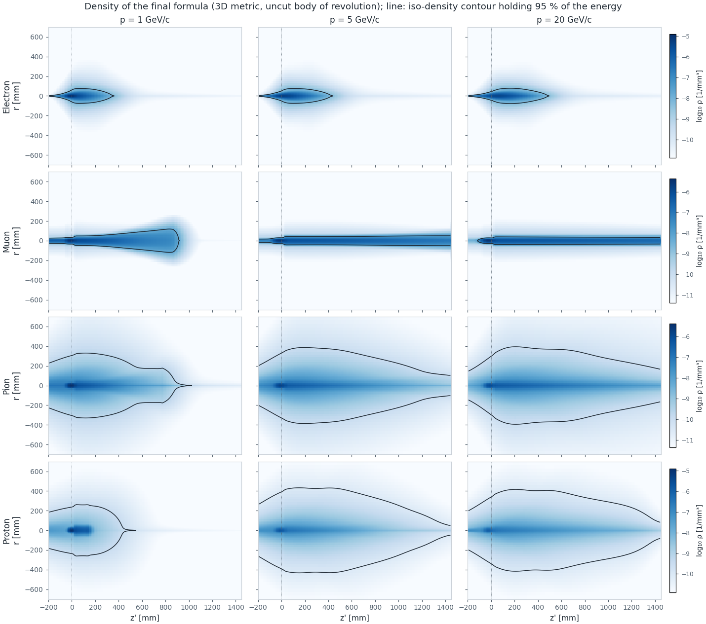

[English](ALL-README.md) | **Magyar**

# Záporalak-képletek – elektron, müon, pion, proton

Az ePIC LFHCal önálló szimulációjában (0,1–20 GeV/c) a beeső részecske átlagos energialerakódásának zárt képlete. A képlet a zápor
saját koordinátáiban adja meg a lerakott energia sűrűségét: z' a mélység a beesés irányában az első találati rétegtől, r a tengelytől
mért távolság. A paraméterek közvetlenül a szimulált találatokra vannak illesztve (maximum likelihood). A pontosság, az összevetések és
az ellenőrzések a [README](README.hu.md)-ben vannak (angolul: [README.md](README.md)).

## Az általános képlet

`ρ(z', r | p) = w_zápor·S + w_nyom·U + w_csúcs·D + w_folt·E + w_távoli·H`

Minden tag külön 1-re normált eloszlás, a w súlyok a tagok energiarészesedései (összegük 1). Minden paraméter az `x = (ln T − v0)/vs`
polinomja, ahol T = √(p² + m²) − m a mozgási energia; σ(·) a logisztikus lépcső.

| tag | képlet | jelentés |
|---|---|---|
| zápor S | `L(z')·T(r│z')` | a másodlagos részecskék hadron- vagy EM-zápora |
| – mélységprofil | plató: `σ((z'−z_s)/w1)·σ((ℓ−z')/w2)·e^(κz')`; müon: gamma `s^(α−1)e^(−(α−1)s/t_max)` | z_s kezdet, w1 felfutás, ℓ vég, w2 lecsengés, κ lassú meredekség |
| – keresztmetszet | `f1·Gauss(r;σ) + f2·R²/(π(r²+R²)²) + f3·e^(−r/λ)/(2πλ(r+1 mm))` | keskeny komponens (σ), Cauchy-test (R), exponenciális udvar (λ); a mélységgel változik |
| tengelytag U | `σ((z'−z_t0)/4 mm)·σ((R(T)−z')/w_R)·e^(−z'/λ_att)·e^(−κ_t·z'/R)·(1−z'/R+0,03)^(−q)` × keresztmetszet | a beeső részecske ionizációs lerakódása: R(T) hatótáv (~1 mm-nél simán levágva), w_R = w·R + 3 mm a vég szélessége, λ_att csillapítás (magkölcsönhatás), κ_t a hatótáv menti fokozatos fogyás, q Bragg-felfutás |
| – a tengelytag szélessége | `σ(z')² = σ0² + (c·(z'/1 m)^k / βp)²`, plusz `f·e^(−r/l)/(2πl(r+1 mm))` | többszörös szórás miatti szélesedés (c, k), delta-elektron-udvar (f, l) |
| csúcs D | Gauss a belépésnél | az első rétegek többletenergiája |
| folt E | Gauss a z' = R(T) helyen | a megálló részecske vége (Bragg-csúcs, befogás) |
| távoli udvar H | `σ(z'/10 mm)·e^(−z'/L)/(r + 1 cm)` | diffúz, messzire jutó energia |

## Így néz ki

A szín a sűrűség tízes alapú logaritmusa (6 nagyságrend), a vonal az energia 95 %-át tartalmazó izoszint (`scripts/formula_maps.py`).
Az elektron kompakt EM-zápor. A müon főleg egy keskeny, a mélységgel szélesedő tengelytag: 1 GeV/c-nél megáll, 5 GeV/c felett átmegy a
detektoron. A pion és a proton széles hadronzápor, kis impulzuson a megálló tengelytaggal. A 98 %-os burkok (szuper-tojás):
[results/detektor_es_alakok/osszehasonlitas.png](results/detektor_es_alakok/osszehasonlitas.png); kétoldalas összefoglaló:
[Protonmodell-Tamas.pdf](Protonmodell-Tamas.pdf).

## Részecskénként röviden

- **Elektron** (64 paraméter): zápor + belépési csúcs + távoli udvar, tengelytag nélkül. A mag σ ≈ 16–19 mm (≈ 0,8 Molière-sugár); a
  csúcs 1 GeV/c-nél az energia 17 %-a, 20 GeV/c-nél 0,35 %.
- **Müon** (129 paraméter): az energia 87–93 %-a a tengelytagban. A tengelytag a többszörös szórás szerint szélesedik (k ≈ 1,41, a Highland-becslés
  1,35–1,41), a hatótáv ≈ 1,06 m/GeV · T, a Bragg-kitevő 0,42 (elmélet 0,43).
- **Pion** (101 paraméter): zápor + tengelytag (a tengelytag 26–53 %); a csillapítási hossz 339 mm ≈ 1,31 λ_π.
- **Proton** (143 paraméter): két rezsim – 1 GeV/c-nél főleg megáll (tengelytag 61 %, csúcs 24 %), 5–20 GeV/c-nél záport kelt (74–81 %);
  a csillapítási hossz 266 mm ≈ 1,26 λ_I.

Hadronoknál a tengelytag szélesedése, delta-udvara és Bragg-kitevője effektív paraméter: a hadronzápor magjának egy részét is ezek írják le.

<!-- KEPLETEK:START (scripts/readme_particle_formulas.py generálja) -->

### Részecskénkénti képletek (3D-mérce, a beírt számok az illesztett értékek)

A fenti általános képlet részecskénként: melyik tag van benne, az állandó paraméterek behelyettesítve, a p-függő paraméterek 1, 5 és 20 GeV/c-nél. Az „energiarész” a detektorba (a ferde belépési sík mögé) eső energia megoszlása. A polinom-együtthatók: `results/particles/<részecske>/formula_coefficients_slab.csv`; minden impulzus és a report-mérce: `formula.hu.md`. Ha a hatótáv nagyobb a detektornál (~1,3 m), a részecske átmegy rajta.

**Elektron** (m = 0,511 MeV; polinomfok és paraméterszám: n = 3, 64)

`ρ(z', r | p) = w_zápor·S + w_csúcs·D + w_távoli·H`

- Zápor mélységprofilja plató: `L(z') ∝ σ((z' − z_s)/w1)·σ((ℓ − z')/w2)·e^(κ·z'/1 m)` (értékek lent).
- Zápor keresztmetszete: `T(r│z') = f_mag·Gauss(r; σ) + f_test·Cauchy(r; R) + f_udvar·e^(−r/λ)/(2πλ(r + 1 mm))`; σ, R, λ és az arányok a mélységgel változnak (lent z' = 100 mm-en).
- Csúcs a belépésnél: Gauss (hely és szélességek lent). Távoli udvar: `H ∝ σ(z'/10 mm)·e^(−z'/767 mm)/(r + 1 cm)`.

| | p = 1 GeV/c | p = 5 GeV/c | p = 20 GeV/c |
|---|---:|---:|---:|
| T (mozgási energia) | 0,999 GeV | 5 GeV | 20 GeV |
| energiarész: zápor | 82,4 % | 94,7 % | 98,7 % |
| energiarész: csúcs | 17 % | 4,38 % | 0,351 % |
| energiarész: távoli udvar | 0,666 % | 0,899 % | 0,951 % |
| zápor kezdete z_s / felfutás w1 | 5,51 / 19,9 mm | 15,1 / 24 mm | 25,2 / 26,3 mm |
| zápor vége ℓ / lecsengés w2 | 42,8 / 60,2 mm | 82,3 / 65,5 mm | 154 / 66,2 mm |
| lassú meredekség κ | −1,44 /m | −1,16 /m | −1,33 /m |
| mag σ / Cauchy R / udvar λ (z' = 100 mm) | 19 / 34,8 / 39,5 mm | 16,5 / 26,7 / 39,5 mm | 15,8 / 20,7 / 39,5 mm |
| arány mag / test / udvar (z' = 100 mm) | 0,74 / 0,13 / 0,13 | 0,82 / 0,04 / 0,13 | 0,85 / 0,02 / 0,13 |
| csúcs helye / σ_z / σ_r | −8,84 / 21,9 / 8,88 mm | −10,6 / 24,6 / 9,15 mm | −12,6 / 18,3 / 9,74 mm |

**Müon** (m = 105,7 MeV; polinomfok és paraméterszám: n = 6, 129)

`ρ(z', r | p) = w_zápor·S + w_nyom·U + w_csúcs·D + w_folt·E + w_távoli·H`

- Zápor mélységprofilja gamma: `L(z') ∝ s^(α−1)·e^(−(α−1)s/t_max)`, s = z' − z0 (értékek lent).
- Zápor keresztmetszete: `T(r│z') = f_mag·Gauss(r; σ) + f_test·Cauchy(r; R) + f_udvar·e^(−r/λ)/(2πλ(r + 1 mm))`; σ, R, λ és az arányok a mélységgel változnak (lent z' = 100 mm-en).
- Tengelytag: hatótáv `R(T) = 1057 mm · (T/GeV)^1,02 − 85 mm` (~1 mm-nél simán levágva); kezdet `σ((z' − 24,2 mm)/4 mm)`, vég `σ((R − z')/w_R)`, w_R = 0,0232·R + 3 mm; csillapítás `e^(−z'/1211 mm)·e^(−0,735·z'/R)`; Bragg-felfutás `(1 − z'/R + 0,03)^(−0,42)`; szélesség `σ(z')² = (15 mm)² + (74,4 mm · (z'/1 m)^1,41 / βp)²`; delta-elektron-udvar `e^(−r/51,4 mm)/(2π·51,4 mm·(r + 1 mm))` (aránya lent).
- Folt a hatótáv végén: Gauss, σ_z = 73,1 mm, σ_r = 85,6 mm.
- Csúcs a belépésnél: Gauss (hely és szélességek lent). Távoli udvar: `H ∝ σ(z'/10 mm)·e^(−z'/1309 mm)/(r + 1 cm)`.

| | p = 1 GeV/c | p = 5 GeV/c | p = 20 GeV/c |
|---|---:|---:|---:|
| T (mozgási energia) | 0,9 GeV | 4,9 GeV | 19,9 GeV |
| energiarész: zápor | 2,42 % | 6,11 % | 1,39 % |
| energiarész: nyom | 90,9 % | 88 % | 92,5 % |
| energiarész: csúcs | 6,38 % | 5,79 % | 5,97 % |
| energiarész: folt | 0,239 % | < 0,01 % | < 0,01 % |
| energiarész: távoli udvar | 0,0852 % | 0,093 % | 0,0942 % |
| zápor kezdete z0 | −48,6 mm | −57,1 mm | −71 mm |
| zápor maximuma t_max | 5,36 mm | 90,9 mm | 240 mm |
| alak α − 1 | 0,0747 | 0,00916 | 0,0508 |
| mag σ / Cauchy R / udvar λ (z' = 100 mm) | 11,2 / 9,51 / 52,3 mm | 11,7 / 16,6 / 51,4 mm | 16 / 295 / 50 mm |
| arány mag / test / udvar (z' = 100 mm) | 0,93 / 0,04 / 0,03 | 0,81 / 0,03 / 0,17 | 0,16 / 0,00 / 0,84 |
| nyom hatótáva R(T) | 864 mm | 5287 mm | 22483 mm |
| delta-udvar aránya | 0,899 % | 0,79 % | 1,3 % |
| csúcs helye / σ_z / σ_r | −9,95 / 23 / 9,2 mm | −15,2 / 27,8 / 9,1 mm | −21,1 / 28,7 / 9,21 mm |

**Proton** (m = 938,3 MeV; polinomfok és paraméterszám: n = 6, 143)

`ρ(z', r | p) = w_zápor·S + w_nyom·U + w_csúcs·D + w_folt·E + w_távoli·H`

- Zápor mélységprofilja plató: `L(z') ∝ σ((z' − z_s)/w1)·σ((ℓ − z')/w2)·e^(κ·z'/1 m)` (értékek lent).
- Zápor keresztmetszete: `T(r│z') = f_mag·Gauss(r; σ) + f_test·Cauchy(r; R) + f_udvar·e^(−r/λ)/(2πλ(r + 1 mm))`; σ, R, λ és az arányok a mélységgel változnak (lent z' = 100 mm-en).
- Tengelytag: hatótáv `R(T) = 757 mm · (T/GeV)^1,78 − 36,5 mm` (~1 mm-nél simán levágva); kezdet `σ((z' − 24,1 mm)/4 mm)`, vég `σ((R − z')/w_R)`, w_R = 0,0579·R + 3 mm; csillapítás `e^(−z'/266 mm)·e^(−2,46·z'/R)`; Bragg-felfutás `(1 − z'/R + 0,03)^(−0,804)`; szélesség `σ(z')² = (18,5 mm)² + (285 mm · (z'/1 m)^2,37 / βp)²`; delta-elektron-udvar `e^(−r/81,5 mm)/(2π·81,5 mm·(r + 1 mm))` (aránya lent).
- Folt a hatótáv végén: Gauss, σ_z = 76,3 mm, σ_r = 81,1 mm.
- Csúcs a belépésnél: Gauss (hely és szélességek lent). Távoli udvar: `H ∝ σ(z'/10 mm)·e^(−z'/962 mm)/(r + 1 cm)`.

| | p = 1 GeV/c | p = 5 GeV/c | p = 20 GeV/c |
|---|---:|---:|---:|
| T (mozgási energia) | 0,433 GeV | 4,15 GeV | 19,1 GeV |
| energiarész: zápor | 14,9 % | 73,6 % | 81,1 % |
| energiarész: nyom | 60,5 % | 21,1 % | 16,8 % |
| energiarész: csúcs | 23,6 % | 4,87 % | 2,12 % |
| energiarész: folt | 0,671 % | < 0,01 % | < 0,01 % |
| energiarész: távoli udvar | 0,383 % | 0,408 % | < 0,01 % |
| zápor kezdete z_s / felfutás w1 | −7,12 / 123 mm | 22,3 / 86,3 mm | 80,7 / 80,2 mm |
| zápor vége ℓ / lecsengés w2 | 132 / 198 mm | 863 / 378 mm | 1330 / 76,2 mm |
| lassú meredekség κ | −3,02 /m | −2,72 /m | −2,65 /m |
| mag σ / Cauchy R / udvar λ (z' = 100 mm) | 84,4 / 121 / 227 mm | 58,8 / 71 / 207 mm | 38,9 / 77,6 / 203 mm |
| arány mag / test / udvar (z' = 100 mm) | 0,08 / 0,87 / 0,05 | 0,08 / 0,80 / 0,13 | 0,13 / 0,76 / 0,10 |
| nyom hatótáva R(T) | 135 mm | 9485 mm | 143749 mm |
| delta-udvar aránya | 3,94 % | 33,4 % | 20,4 % |
| csúcs helye / σ_z / σ_r | −3,17 / 13,7 / 10,1 mm | −7,75 / 22,1 / 11,5 mm | −18,5 / 23,8 / 11,6 mm |

**Pion** (m = 139,6 MeV; polinomfok és paraméterszám: n = 3, 101)

`ρ(z', r | p) = w_zápor·S + w_nyom·U + w_csúcs·D + w_folt·E + w_távoli·H`

- Zápor mélységprofilja plató: `L(z') ∝ σ((z' − z_s)/w1)·σ((ℓ − z')/w2)·e^(κ·z'/1 m)` (értékek lent).
- Zápor keresztmetszete: `T(r│z') = f_mag·Gauss(r; σ) + f_test·Cauchy(r; R) + f_udvar·e^(−r/λ)/(2πλ(r + 1 mm))`; σ, R, λ és az arányok a mélységgel változnak (lent z' = 100 mm-en).
- Tengelytag: hatótáv `R(T) = 952 mm · (T/GeV)^1,26 − 26,9 mm` (~1 mm-nél simán levágva); kezdet `σ((z' − 28,4 mm)/4 mm)`, vég `σ((R − z')/w_R)`, w_R = 0,0861·R + 3 mm; csillapítás `e^(−z'/339 mm)·e^(−2,25·z'/R)`; Bragg-felfutás `(1 − z'/R + 0,03)^(−0,526)`; szélesség `σ(z')² = (20,1 mm)² + (135 mm · (z'/1 m)^1,72 / βp)²`; delta-elektron-udvar `e^(−r/69,4 mm)/(2π·69,4 mm·(r + 1 mm))` (aránya lent).
- Folt a hatótáv végén: Gauss, σ_z = 103 mm, σ_r = 130 mm.
- Csúcs a belépésnél: Gauss (hely és szélességek lent). Távoli udvar: `H ∝ σ(z'/10 mm)·e^(−z'/701 mm)/(r + 1 cm)`.

| | p = 1 GeV/c | p = 5 GeV/c | p = 20 GeV/c |
|---|---:|---:|---:|
| T (mozgási energia) | 0,87 GeV | 4,86 GeV | 19,9 GeV |
| energiarész: zápor | 43 % | 68,1 % | 68,5 % |
| energiarész: nyom | 43 % | 26,7 % | 28,9 % |
| energiarész: csúcs | 13,4 % | 4,93 % | 2,64 % |
| energiarész: folt | 0,0701 % | < 0,01 % | < 0,01 % |
| energiarész: távoli udvar | 0,52 % | 0,176 % | 0,0112 % |
| zápor kezdete z_s / felfutás w1 | 12,8 / 111 mm | 44,8 / 80,8 mm | 84,7 / 66,6 mm |
| zápor vége ℓ / lecsengés w2 | 56,9 / 167 mm | 224 / 423 mm | 1207 / 596 mm |
| lassú meredekség κ | −1,99 /m | −2 /m | −2,03 /m |
| mag σ / Cauchy R / udvar λ (z' = 100 mm) | 68 / 96,3 / 216 mm | 71,9 / 67,5 / 206 mm | 59,1 / 67,8 / 196 mm |
| arány mag / test / udvar (z' = 100 mm) | 0,27 / 0,66 / 0,07 | 0,13 / 0,77 / 0,11 | 0,12 / 0,72 / 0,16 |
| nyom hatótáva R(T) | 772 mm | 6980 mm | 41375 mm |
| delta-udvar aránya | 16,3 % | 19,3 % | 14,9 % |
| csúcs helye / σ_z / σ_r | −5,3 / 20,8 / 11,1 mm | −7,04 / 23,9 / 11,6 mm | −9,26 / 23,5 / 11,4 mm |

<!-- KEPLETEK:END -->
