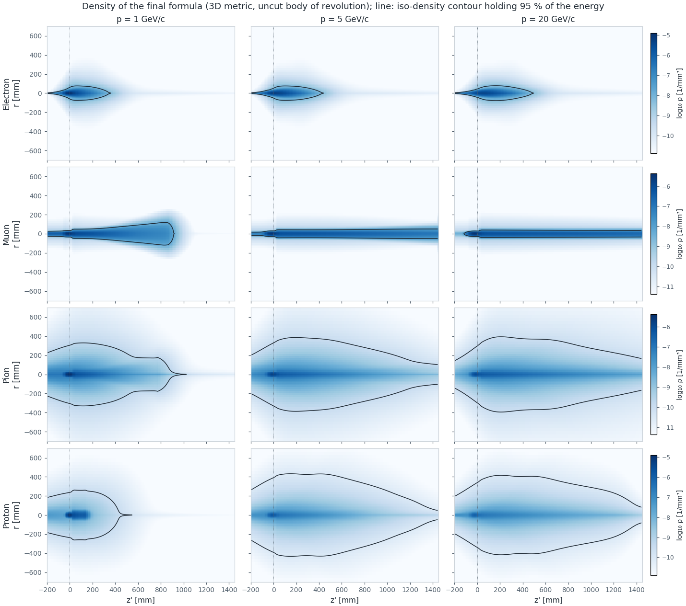

**English** | [Magyar](ALL-README.hu.md)

# Shower-shape formulas – electron, muon, pion, proton

A closed formula for the average energy deposition of the incoming particle in the standalone simulation of the ePIC LFHCal
(0.1–20 GeV/c). It gives the density of the deposited energy in the shower's own coordinates: z' is the depth along the direction of
incidence, measured from the first hit layer, and r is the distance from the axis. The parameters are fitted directly to the simulated
hits (maximum likelihood). Accuracy, comparisons and checks are in the [README](README.md).

## The general formula

`ρ(z', r | p) = w_zápor·S + w_nyom·U + w_csúcs·D + w_folt·E + w_távoli·H`

The subscripts are the Hungarian names of the terms: zápor = shower, nyom = track, csúcs = entry spike, folt = end-of-range blob,
távoli = far halo. Each term is a separately normalised distribution, and the weights w are the energy shares of the terms (they sum
to 1). Every parameter is a polynomial in `x = (ln T − v0)/vs`, where T = √(p² + m²) − m is the kinetic energy; σ(·) is the logistic
step.

| term | formula | meaning |
|---|---|---|
| shower S | `L(z')·T(r│z')` | the hadronic or electromagnetic shower of the secondary particles |
| – depth profile | plateau: `σ((z'−z_s)/w1)·σ((ℓ−z')/w2)·e^(κz')`; muon: gamma `s^(α−1)e^(−(α−1)s/t_max)` | z_s start, w1 rise, ℓ end, w2 fall-off, κ slow slope |
| – cross-section | `f1·Gauss(r;σ) + f2·R²/(π(r²+R²)²) + f3·e^(−r/λ)/(2πλ(r+1 mm))` | narrow core (σ), Cauchy body (R), exponential halo (λ); all vary with depth |
| track U | `σ((z'−z_t0)/4 mm)·σ((R(T)−z')/w_R)·e^(−z'/λ_att)·e^(−κ_t·z'/R)·(1−z'/R+0.03)^(−q)` × cross-section | ionisation track of the incoming particle: R(T) range (smoothly floored at ~1 mm), w_R = w·R + 3 mm end width, λ_att attenuation (nuclear interaction), κ_t gradual fading along the range, q Bragg rise |
| – track width | `σ(z')² = σ0² + (c·(z'/1 m)^k / βp)²`, plus `f·e^(−r/l)/(2πl(r+1 mm))` | widening by multiple scattering (c, k), delta-electron halo (f, l) |
| spike D | Gaussian at the entrance | extra energy in the first layers |
| blob E | Gaussian at z' = R(T) | end of a stopping particle (Bragg peak, capture) |
| far halo H | `σ(z'/10 mm)·e^(−z'/L)/(r + 1 cm)` | diffuse energy that travels far |

## What it looks like

Colour: decimal logarithm of the density (6 decades); line: the iso-density contour that holds 95% of the energy
(`scripts/formula_maps.py`). The electron gives a compact electromagnetic shower. The muon is mainly a narrow track that widens with
depth: at 1 GeV/c it stops, above 5 GeV/c it passes through the detector. The pion and the proton give broad hadronic showers, with the
stopping track at low momentum. The 98% envelope bodies (super-egg):
[results/detektor_es_alakok/osszehasonlitas.png](results/detektor_es_alakok/osszehasonlitas.png); a two-page summary (in Hungarian):
[Protonmodell-Tamas.pdf](Protonmodell-Tamas.pdf).

## Per particle in brief

- **Electron** (64 parameters): shower + entry spike + far halo, no track. Core σ ≈ 16–19 mm (≈ 0.8 Molière radius); the spike is 17%
  of the energy at 1 GeV/c and 0.35% at 20 GeV/c.
- **Muon** (129 parameters): 87–93% of the energy is in the track. The track widens as multiple scattering predicts (k ≈ 1.41, Highland
  estimate 1.35–1.41); range ≈ 1.06 m/GeV · T; Bragg exponent 0.42 (theory 0.43).
- **Pion** (101 parameters): shower + track (the track carries 26–53%); attenuation length 339 mm ≈ 1.31 λ_π.
- **Proton** (143 parameters): two regimes – at 1 GeV/c it mainly stops (track 61%, spike 24%), at 5–20 GeV/c it makes a shower
  (74–81%); attenuation length 266 mm ≈ 1.26 λ_I.

For hadrons, the widening, the delta halo and the Bragg exponent of the track are effective parameters: they also describe part of the
core of the hadronic shower.

<!-- KEPLETEK:START (scripts/readme_particle_formulas.py generates this block) -->

### Per-particle formulas (3D metric; the numbers are the fitted values)

The general formula above, per particle: the terms it contains, the constant parameters substituted, and the momentum-dependent ones at 1, 5 and 20 GeV/c. The “energy share” is the split of the energy deposited in the detector (behind the tilted entrance face). Polynomial coefficients: `results/particles/<particle>/formula_coefficients_slab.csv`; all momenta and the report metric: `formula.md`. If the range exceeds the depth of the detector (~1.3 m), the particle passes through it.

**Electron** (m = 0.511 MeV; polynomial degree and number of parameters: n = 3, 64)

`ρ(z', r | p) = w_zápor·S + w_csúcs·D + w_távoli·H`

- Shower depth profile, plateau: `L(z') ∝ σ((z' − z_s)/w1)·σ((ℓ − z')/w2)·e^(κ·z'/1 m)` (values below).
- Shower cross-section: `T(r│z') = f_core·Gauss(r; σ) + f_body·Cauchy(r; R) + f_halo·e^(−r/λ)/(2πλ(r + 1 mm))`; σ, R, λ and the fractions vary with depth (below at z' = 100 mm).
- Entry spike: Gaussian (position and widths below). Far halo: `H ∝ σ(z'/10 mm)·e^(−z'/767 mm)/(r + 1 cm)`.

| | p = 1 GeV/c | p = 5 GeV/c | p = 20 GeV/c |
|---|---:|---:|---:|
| T (kinetic energy) | 0.999 GeV | 5 GeV | 20 GeV |
| energy share: shower | 82.4% | 94.7% | 98.7% |
| energy share: spike | 17% | 4.38% | 0.351% |
| energy share: far halo | 0.666% | 0.899% | 0.951% |
| shower start z_s / rise w1 | 5.51 / 19.9 mm | 15.1 / 24 mm | 25.2 / 26.3 mm |
| shower end ℓ / fall-off w2 | 42.8 / 60.2 mm | 82.3 / 65.5 mm | 154 / 66.2 mm |
| slow slope κ | −1.44 /m | −1.16 /m | −1.33 /m |
| core σ / Cauchy R / halo λ (z' = 100 mm) | 19 / 34.8 / 39.5 mm | 16.5 / 26.7 / 39.5 mm | 15.8 / 20.7 / 39.5 mm |
| fractions core / body / halo (z' = 100 mm) | 0.74 / 0.13 / 0.13 | 0.82 / 0.04 / 0.13 | 0.85 / 0.02 / 0.13 |
| spike position / σ_z / σ_r | −8.84 / 21.9 / 8.88 mm | −10.6 / 24.6 / 9.15 mm | −12.6 / 18.3 / 9.74 mm |

**Muon** (m = 105.7 MeV; polynomial degree and number of parameters: n = 6, 129)

`ρ(z', r | p) = w_zápor·S + w_nyom·U + w_csúcs·D + w_folt·E + w_távoli·H`

- Shower depth profile, gamma: `L(z') ∝ s^(α−1)·e^(−(α−1)s/t_max)`, s = z' − z0 (values below).
- Shower cross-section: `T(r│z') = f_core·Gauss(r; σ) + f_body·Cauchy(r; R) + f_halo·e^(−r/λ)/(2πλ(r + 1 mm))`; σ, R, λ and the fractions vary with depth (below at z' = 100 mm).
- Track: range `R(T) = 1057 mm · (T/GeV)^1.02 − 85 mm` (smoothly floored at ~1 mm); start `σ((z' − 24.2 mm)/4 mm)`, end `σ((R − z')/w_R)` with w_R = 0.0232·R + 3 mm; attenuation `e^(−z'/1211 mm)·e^(−0.735·z'/R)`; Bragg rise `(1 − z'/R + 0.03)^(−0.42)`; width `σ(z')² = (15 mm)² + (74.4 mm · (z'/1 m)^1.41 / βp)²`; delta-electron halo `e^(−r/51.4 mm)/(2π·51.4 mm·(r + 1 mm))` (its share below).
- End-of-range blob: Gaussian, σ_z = 73.1 mm, σ_r = 85.6 mm.
- Entry spike: Gaussian (position and widths below). Far halo: `H ∝ σ(z'/10 mm)·e^(−z'/1309 mm)/(r + 1 cm)`.

| | p = 1 GeV/c | p = 5 GeV/c | p = 20 GeV/c |
|---|---:|---:|---:|
| T (kinetic energy) | 0.9 GeV | 4.9 GeV | 19.9 GeV |
| energy share: shower | 2.42% | 6.11% | 1.39% |
| energy share: track | 90.9% | 88% | 92.5% |
| energy share: spike | 6.38% | 5.79% | 5.97% |
| energy share: blob | 0.239% | < 0.01% | < 0.01% |
| energy share: far halo | 0.0852% | 0.093% | 0.0942% |
| shower start z0 | −48.6 mm | −57.1 mm | −71 mm |
| shower maximum t_max | 5.36 mm | 90.9 mm | 240 mm |
| shape α − 1 | 0.0747 | 0.00916 | 0.0508 |
| core σ / Cauchy R / halo λ (z' = 100 mm) | 11.2 / 9.51 / 52.3 mm | 11.7 / 16.6 / 51.4 mm | 16 / 295 / 50 mm |
| fractions core / body / halo (z' = 100 mm) | 0.93 / 0.04 / 0.03 | 0.81 / 0.03 / 0.17 | 0.16 / 0.00 / 0.84 |
| track range R(T) | 864 mm | 5287 mm | 22483 mm |
| delta-halo share | 0.899% | 0.79% | 1.3% |
| spike position / σ_z / σ_r | −9.95 / 23 / 9.2 mm | −15.2 / 27.8 / 9.1 mm | −21.1 / 28.7 / 9.21 mm |

**Proton** (m = 938.3 MeV; polynomial degree and number of parameters: n = 6, 143)

`ρ(z', r | p) = w_zápor·S + w_nyom·U + w_csúcs·D + w_folt·E + w_távoli·H`

- Shower depth profile, plateau: `L(z') ∝ σ((z' − z_s)/w1)·σ((ℓ − z')/w2)·e^(κ·z'/1 m)` (values below).
- Shower cross-section: `T(r│z') = f_core·Gauss(r; σ) + f_body·Cauchy(r; R) + f_halo·e^(−r/λ)/(2πλ(r + 1 mm))`; σ, R, λ and the fractions vary with depth (below at z' = 100 mm).
- Track: range `R(T) = 757 mm · (T/GeV)^1.78 − 36.5 mm` (smoothly floored at ~1 mm); start `σ((z' − 24.1 mm)/4 mm)`, end `σ((R − z')/w_R)` with w_R = 0.0579·R + 3 mm; attenuation `e^(−z'/266 mm)·e^(−2.46·z'/R)`; Bragg rise `(1 − z'/R + 0.03)^(−0.804)`; width `σ(z')² = (18.5 mm)² + (285 mm · (z'/1 m)^2.37 / βp)²`; delta-electron halo `e^(−r/81.5 mm)/(2π·81.5 mm·(r + 1 mm))` (its share below).
- End-of-range blob: Gaussian, σ_z = 76.3 mm, σ_r = 81.1 mm.
- Entry spike: Gaussian (position and widths below). Far halo: `H ∝ σ(z'/10 mm)·e^(−z'/962 mm)/(r + 1 cm)`.

| | p = 1 GeV/c | p = 5 GeV/c | p = 20 GeV/c |
|---|---:|---:|---:|
| T (kinetic energy) | 0.433 GeV | 4.15 GeV | 19.1 GeV |
| energy share: shower | 14.9% | 73.6% | 81.1% |
| energy share: track | 60.5% | 21.1% | 16.8% |
| energy share: spike | 23.6% | 4.87% | 2.12% |
| energy share: blob | 0.671% | < 0.01% | < 0.01% |
| energy share: far halo | 0.383% | 0.408% | < 0.01% |
| shower start z_s / rise w1 | −7.12 / 123 mm | 22.3 / 86.3 mm | 80.7 / 80.2 mm |
| shower end ℓ / fall-off w2 | 132 / 198 mm | 863 / 378 mm | 1330 / 76.2 mm |
| slow slope κ | −3.02 /m | −2.72 /m | −2.65 /m |
| core σ / Cauchy R / halo λ (z' = 100 mm) | 84.4 / 121 / 227 mm | 58.8 / 71 / 207 mm | 38.9 / 77.6 / 203 mm |
| fractions core / body / halo (z' = 100 mm) | 0.08 / 0.87 / 0.05 | 0.08 / 0.80 / 0.13 | 0.13 / 0.76 / 0.10 |
| track range R(T) | 135 mm | 9485 mm | 143749 mm |
| delta-halo share | 3.94% | 33.4% | 20.4% |
| spike position / σ_z / σ_r | −3.17 / 13.7 / 10.1 mm | −7.75 / 22.1 / 11.5 mm | −18.5 / 23.8 / 11.6 mm |

**Pion** (m = 139.6 MeV; polynomial degree and number of parameters: n = 3, 101)

`ρ(z', r | p) = w_zápor·S + w_nyom·U + w_csúcs·D + w_folt·E + w_távoli·H`

- Shower depth profile, plateau: `L(z') ∝ σ((z' − z_s)/w1)·σ((ℓ − z')/w2)·e^(κ·z'/1 m)` (values below).
- Shower cross-section: `T(r│z') = f_core·Gauss(r; σ) + f_body·Cauchy(r; R) + f_halo·e^(−r/λ)/(2πλ(r + 1 mm))`; σ, R, λ and the fractions vary with depth (below at z' = 100 mm).
- Track: range `R(T) = 952 mm · (T/GeV)^1.26 − 26.9 mm` (smoothly floored at ~1 mm); start `σ((z' − 28.4 mm)/4 mm)`, end `σ((R − z')/w_R)` with w_R = 0.0861·R + 3 mm; attenuation `e^(−z'/339 mm)·e^(−2.25·z'/R)`; Bragg rise `(1 − z'/R + 0.03)^(−0.526)`; width `σ(z')² = (20.1 mm)² + (135 mm · (z'/1 m)^1.72 / βp)²`; delta-electron halo `e^(−r/69.4 mm)/(2π·69.4 mm·(r + 1 mm))` (its share below).
- End-of-range blob: Gaussian, σ_z = 103 mm, σ_r = 130 mm.
- Entry spike: Gaussian (position and widths below). Far halo: `H ∝ σ(z'/10 mm)·e^(−z'/701 mm)/(r + 1 cm)`.

| | p = 1 GeV/c | p = 5 GeV/c | p = 20 GeV/c |
|---|---:|---:|---:|
| T (kinetic energy) | 0.87 GeV | 4.86 GeV | 19.9 GeV |
| energy share: shower | 43% | 68.1% | 68.5% |
| energy share: track | 43% | 26.7% | 28.9% |
| energy share: spike | 13.4% | 4.93% | 2.64% |
| energy share: blob | 0.0701% | < 0.01% | < 0.01% |
| energy share: far halo | 0.52% | 0.176% | 0.0112% |
| shower start z_s / rise w1 | 12.8 / 111 mm | 44.8 / 80.8 mm | 84.7 / 66.6 mm |
| shower end ℓ / fall-off w2 | 56.9 / 167 mm | 224 / 423 mm | 1207 / 596 mm |
| slow slope κ | −1.99 /m | −2 /m | −2.03 /m |
| core σ / Cauchy R / halo λ (z' = 100 mm) | 68 / 96.3 / 216 mm | 71.9 / 67.5 / 206 mm | 59.1 / 67.8 / 196 mm |
| fractions core / body / halo (z' = 100 mm) | 0.27 / 0.66 / 0.07 | 0.13 / 0.77 / 0.11 | 0.12 / 0.72 / 0.16 |
| track range R(T) | 772 mm | 6980 mm | 41375 mm |
| delta-halo share | 16.3% | 19.3% | 14.9% |
| spike position / σ_z / σ_r | −5.3 / 20.8 / 11.1 mm | −7.04 / 23.9 / 11.6 mm | −9.26 / 23.5 / 11.4 mm |

<!-- KEPLETEK:END -->
