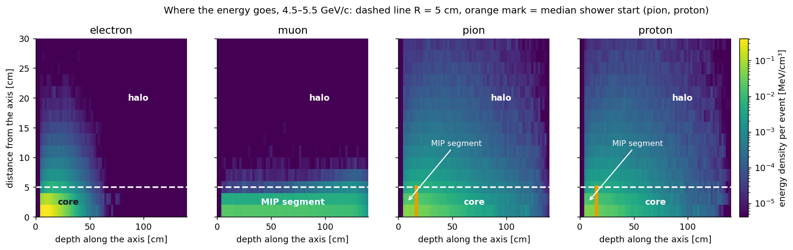
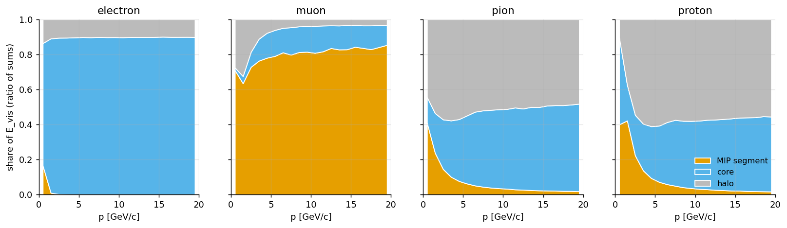
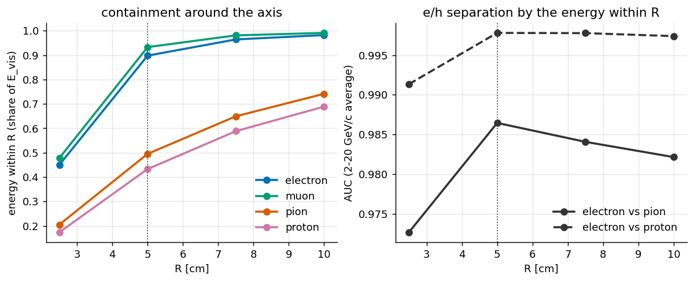

[English](Q1.md) | **Magyar**

# Q1 – Mi a mag, és hogyan néz ki a teljes záporon belül az energia függvényében?

Részecske-issue [#1](https://github.com/EgyipTomi425/particle/issues/1). Notebook: [`notebooks/09_axis_core.ipynb`](../../notebooks/09_axis_core.ipynb).

**Honnan jönnek a számok.** Minden szám az ePIC LFHCal szimulációjából (Geant4, FTFP_BERT) származik. A jelöletlen számokat a
szimulált találati energiákból számoltuk, ahogy a detektor rögzítené őket (zaj nélkül, csempénként). Az *(igazság)* jelű számok
olyan információt használnak, amit egy valódi detektor nem ad: melyik részecske adott le elsőként energiát egy cellában, és hogyan
ért véget a primer részecske nyoma (a leányrészecskéiből). A becsléseket és az irodalmi értékeket külön megnevezzük.

**Válasz.** A mag a tengelytől (a beérkezés iránya a belépési ponttól, z = 3620 mm-es front) **R = 5 cm**-en belüli látható energia a
zápor kezdetétől; a kezdet előtti tengely menti rész a MIP-szakasz, az 5 cm-nél távolabbi energia a halo, így
`E_vis = E_MIP + E_core + E_halo`. Az elektronzáporban a mag 2 GeV/c-től legalább 0,89 (a halo legfeljebb 0,11); a
müoneseményekben a MIP-szakasz 1 GeV/c-től 0,63–0,85. A pionnál és a protonnál a mag az impulzussal nő (pion
0,23 → 0,50, proton 0,20 → 0,43 az 1–2 és a 19–20 GeV/c között),
a MIP-szakasz csökken (pion 0,24 → 0,02, proton 0,42 → 0,02); 2 GeV/c-től a
halo az energia 0,48–0,61 részét viszi.

*Hová kerül az energia* (4,5–5,5 GeV/c, eseményenkénti átlagos energiasűrűség): a szaggatott vonal R = 5 cm, a narancssárga jel a
pionok és protonok zápor-kezdetének mediánja. 5 cm-en belül a jel előtt: MIP-szakasz; utána: mag; 5 cm-en kívül: halo.

Az `E_vis` megoszlása (összegek aránya; az eseményátlagok a notebookban és a `q1_fractions.csv`-ben):

| részecske | p [GeV/c] | MIP-szakasz | mag | halo |
|---|---|---|---|---|
| elektron | 1–2 | 0,01 | 0,88 | 0,11 |
| elektron | 4–5 | 0,00 | 0,90 | 0,10 |
| elektron | 9–10 | 0,00 | 0,90 | 0,10 |
| elektron | 19–20 | 0,00 | 0,90 | 0,10 |
| müon | 1–2 | 0,63 | 0,04 | 0,33 |
| müon | 4–5 | 0,78 | 0,14 | 0,08 |
| müon | 9–10 | 0,81 | 0,15 | 0,04 |
| müon | 19–20 | 0,85 | 0,11 | 0,03 |
| pion | 1–2 | 0,24 | 0,23 | 0,54 |
| pion | 4–5 | 0,08 | 0,35 | 0,57 |
| pion | 9–10 | 0,03 | 0,45 | 0,51 |
| pion | 19–20 | 0,02 | 0,50 | 0,48 |
| proton | 1–2 | 0,42 | 0,20 | 0,37 |
| proton | 4–5 | 0,09 | 0,30 | 0,61 |
| proton | 9–10 | 0,04 | 0,38 | 0,58 |
| proton | 19–20 | 0,02 | 0,43 | 0,56 |

## Miért 5 cm

| részecske | R = 2,5 cm | 5 cm | 7,5 cm | 10 cm | 5 cm, cellaközép-szabály |
|---|---|---|---|---|---|
| elektron | 0,45 | 0,90 | 0,96 | 0,98 | 0,93 |
| müon | 0,48 | 0,93 | 0,98 | 0,99 | 0,96 |
| pion | 0,20 | 0,50 | 0,65 | 0,74 | 0,53 |
| proton | 0,17 | 0,43 | 0,59 | 0,69 | 0,46 |

1. **Müonok.** A müon 10 cm-en belüli energiájának 48 %-a 2,5 cm-en, 94 %-a
   5 cm-en, 99 %-a 7,5 cm-en belül van: 48,6 mm-es cellákkal az 5 cm a legkisebb sugár, amely a primer által
   átszelt cellá(ka)t tartalmazza. 5 cm alatt az eredmény attól a feltevéstől függ, hogy a cellán belül egyenletes az energia
   (felezés).
2. **Elektronok.** 5 cm = a rétegszerkezet 2,3 Molière-sugara (R_M = 22,1 mm a vas és a
   polisztirol PDG-adataiból, `scripts/core_mip_estimates.py`); az elektron energiájának
   90 %-a ezen belül van.
3. **Elektron–hadron szétválasztás.** Az R-en belüli energiával az elektron–hadron szétválasztás (AUC 2–20 GeV/c átlaga,
   R = 2,5 / 5 / 7,5 / 10 cm) e/π-re 0,973 / 0,986 / 0,984 / 0,982, e/p-re 0,991 / 0,998 / 0,998 / 0,997.

**Cellaközép-szabály vagy arányos felezés?** A cellaközép-szabály az egész cellát a maghoz sorolja, ha a középpontja 5 cm-en belül van;
kb. 0,03-dal több magot ad, mint az arányos felezés (a táblázat utolsó oszlopa). Az oldalak az arányos felezést használják;
mindkettő el van mentve (`f_near_R50`, `f_near_centre_R50`).

**Kiválasztás.** A belépési pont a műszerezett területen van, és a tengely mind a 60 rétegben 10 cm-rel a terület szélén belül marad
(a tengelytől ±x és ±y irányban 10 cm-re lévő pontok a műszerezett területen vannak; az események 59 %-a);
csak a gyors (t < 100 ns) lerakódások számítanak.
