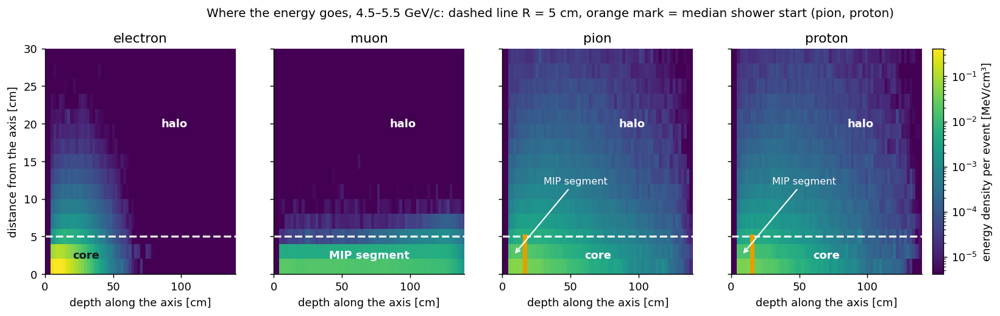
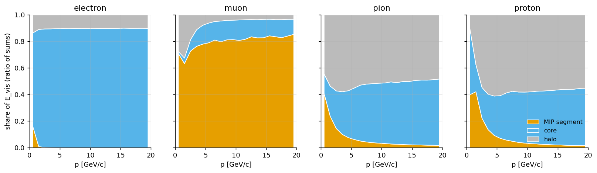
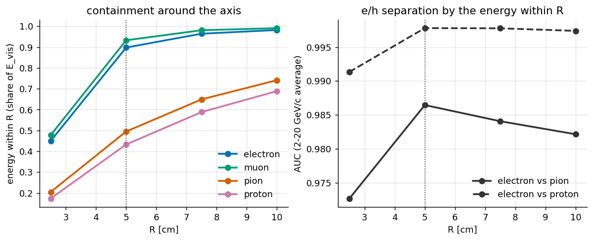

**English** | [Magyar](Q1.hu.md)

# Q1 – What is the core, and how does it look within the whole shower as a function of energy?

Particle issue [#1](https://github.com/EgyipTomi425/particle/issues/1). Notebook: [`notebooks/09_axis_core.ipynb`](../../notebooks/09_axis_core.ipynb).

**How the numbers were obtained.** All numbers come from the ePIC LFHCal simulation (Geant4, FTFP_BERT). Unmarked numbers are
computed from the simulated hit energies, as the detector would record them (noise-free, tile by tile). Numbers marked *(truth)*
use information that a real detector does not provide: which particle deposited energy first in a cell, and how the primary
particle's track ended (read from its daughter particles). Estimates and literature values are named as such.

**Answer.** The core is the visible energy within **R = 5 cm** of the axis (the incoming direction from the entry point at the front
face, z = 3620 mm), taken from the shower start on; the axis region before the start is the MIP segment, everything farther than 5 cm
is the halo, so `E_vis = E_MIP + E_core + E_halo`. In electron showers the core holds at least 0.89 from 2 GeV/c on
(halo at most 0.11); in muon events the MIP segment holds 0.63–0.85 from 1 GeV/c on. For pions and protons the core
grows with momentum (pion 0.23 → 0.50, proton 0.20 → 0.43 from
1–2 to 19–20 GeV/c) while the MIP segment shrinks (pion 0.24 → 0.02, proton 0.42 →
0.02); from 2 GeV/c on the halo holds 0.48–0.61 of the energy.

*Where the energy goes* (4.5–5.5 GeV/c, mean energy density per event): the dashed line is R = 5 cm, the orange mark the median
shower start of pions and protons. Inside 5 cm, before the mark: MIP segment; after it: core; outside 5 cm: halo.

Shares of `E_vis` (ratio of sums; the event means are in the notebook and in `q1_fractions.csv`):

| particle | p [GeV/c] | MIP segment | core | halo |
|---|---|---|---|---|
| electron | 1–2 | 0.01 | 0.88 | 0.11 |
| electron | 4–5 | 0.00 | 0.90 | 0.10 |
| electron | 9–10 | 0.00 | 0.90 | 0.10 |
| electron | 19–20 | 0.00 | 0.90 | 0.10 |
| muon | 1–2 | 0.63 | 0.04 | 0.33 |
| muon | 4–5 | 0.78 | 0.14 | 0.08 |
| muon | 9–10 | 0.81 | 0.15 | 0.04 |
| muon | 19–20 | 0.85 | 0.11 | 0.03 |
| pion | 1–2 | 0.24 | 0.23 | 0.54 |
| pion | 4–5 | 0.08 | 0.35 | 0.57 |
| pion | 9–10 | 0.03 | 0.45 | 0.51 |
| pion | 19–20 | 0.02 | 0.50 | 0.48 |
| proton | 1–2 | 0.42 | 0.20 | 0.37 |
| proton | 4–5 | 0.09 | 0.30 | 0.61 |
| proton | 9–10 | 0.04 | 0.38 | 0.58 |
| proton | 19–20 | 0.02 | 0.43 | 0.56 |

## Why 5 cm

| particle | R = 2.5 cm | 5 cm | 7.5 cm | 10 cm | 5 cm, cell-centre rule |
|---|---|---|---|---|---|
| electron | 0.45 | 0.90 | 0.96 | 0.98 | 0.93 |
| muon | 0.48 | 0.93 | 0.98 | 0.99 | 0.96 |
| pion | 0.20 | 0.50 | 0.65 | 0.74 | 0.53 |
| proton | 0.17 | 0.43 | 0.59 | 0.69 | 0.46 |

1. **Muons.** Of the muon energy within 10 cm, 48 % lies within 2.5 cm, 94 % within 5 cm and
   99 % within 7.5 cm: with 48.6 mm cells, 5 cm is the smallest radius that holds the cell(s) the primary crosses.
   Below 5 cm the result depends on the assumption that the energy is uniform within a cell (folding).
2. **Electrons.** 5 cm = 2.3 Molière radii of the layer stack (R_M = 22.1 mm from the
   PDG values of iron and polystyrene, `scripts/core_mip_estimates.py`); 90 % of the electron energy lies within it.
3. **Electron/hadron separation.** The separation by the energy within R (AUC averaged over 2–20 GeV/c, R = 2.5 / 5 / 7.5 / 10 cm)
   is 0.973 / 0.986 / 0.984 / 0.982 for e/π and 0.991 / 0.998 / 0.998 / 0.997 for e/p.

**Cell-centre rule or proportional sharing?** The cell-centre rule assigns a whole cell to the core when its centre is within 5 cm; it
gives about 0.03 more core than proportional sharing (table, last column). The pages use proportional sharing; both are stored
(`f_near_R50`, `f_near_centre_R50`).

**Selection.** Entry point in the instrumented area and the axis 10 cm inside the area in all 60 layers (the points 10 cm
from the axis in ±x and ±y lie in the instrumented area; 59 % of the events); only prompt deposits (t < 100 ns).
