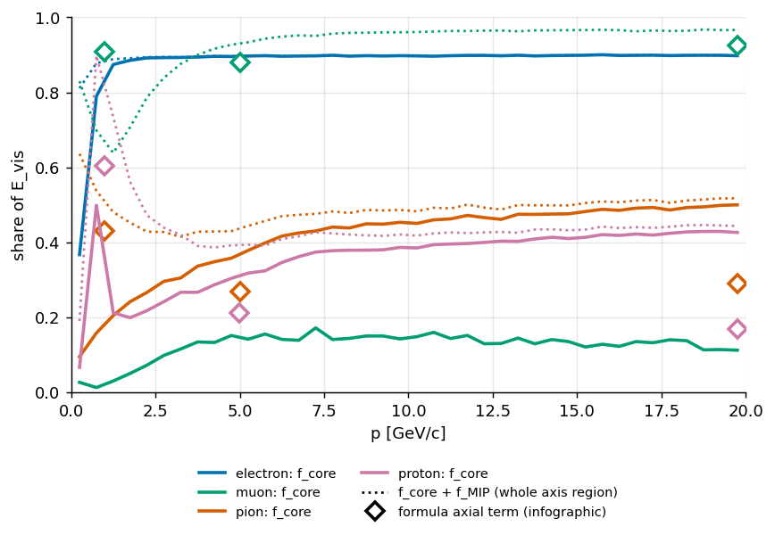
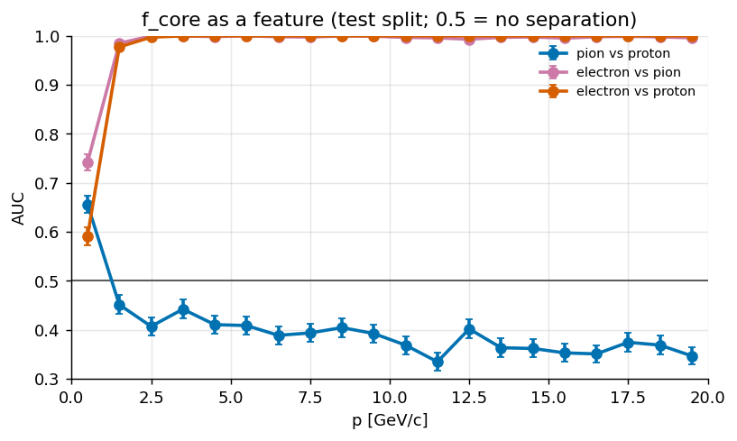

[English](Q2.md) | **Magyar**

# Q2 – Valóban ~60 % a proton magaránya 1 GeV/c-n, és ~43 % a pioné?

Részecske-issue [#1](https://github.com/EgyipTomi425/particle/issues/1). Notebook: [`notebooks/09_axis_core.ipynb`](../../notebooks/09_axis_core.ipynb).

**Honnan jönnek a számok.** Minden szám az ePIC LFHCal szimulációjából (Geant4, FTFP_BERT) származik. A jelöletlen számokat a
szimulált találati energiákból számoltuk, ahogy a detektor rögzítené őket (zaj nélkül, csempénként). Az *(igazság)* jelű számok
olyan információt használnak, amit egy valódi detektor nem ad: melyik részecske adott le elsőként energiát egy cellában, és hogyan
ért véget a primer részecske nyoma (a leányrészecskéiből). A becsléseket és az irodalmi értékeket külön megnevezzük.

**Válasz.** Az issue #1 definíciójával mérve 1 GeV/c-n **f_core = 0,40 ± 0,01 a protonra és
0,19 ± 0,01 a pionra** (összegek aránya; eseményátlag 0,33 és 0,18).
Az infografika számai (0,61 és 0,43) az illesztett alakképlet *tengelytagjának* részarányai
(a képletben ez a tag írja le a primer tengely menti áthaladását), nem az issue #1 szerinti f_core. Összehasonlításképpen: a teljes
tengely menti tartomány `f_core + f_MIP` = 0,87 (proton) és 0,51 (pion); *(igazság)* a primer
saját részaránya az `E_vis`-ből: 0,68 és 0,25.

| részecske | p [GeV/c] | f_core (összegek aránya) | f_core (eseményátlag) | f_MIP | f_core + f_MIP | infografika (tengelytag) | igazság: a primer része | igazság: f_core a primer áthaladásából | igazság: nincs primer cella / rugalmatlan / megáll |
|---|---|---|---|---|---|---|---|---|---|
| elektron | 1 | 0,85 ± 0,01 | 0,83 | 0,04 | 0,89 | 0,00 | 0,05 | 0,04 | 59 % / 0 % / 41 % |
| elektron | 5 | 0,90 ± 0,00 | 0,89 | 0,00 | 0,90 | 0,00 | 0,01 | 0,01 | 69 % / 0 % / 31 % |
| elektron | 20 | 0,90 ± 0,00 | 0,90 | 0,00 | 0,90 | 0,00 | 0,00 | 0,00 | 78 % / 0 % / 22 % |
| müon | 1 | 0,02 ± 0,00 | 0,02 | 0,65 | 0,67 | 0,91 | 0,93 | 0,02 | 0 % / 51 % / 49 % |
| müon | 5 | 0,15 ± 0,01 | 0,12 | 0,78 | 0,93 | 0,88 | 0,81 | 0,10 | 0 % / 0 % / 14 % |
| müon | 20 | 0,11 ± 0,01 | 0,06 | 0,85 | 0,97 | 0,93 | 0,74 | 0,04 | 0 % / 0 % / 15 % |
| pion | 1 | 0,19 ± 0,01 | 0,18 | 0,32 | 0,51 | 0,43 | 0,25 | 0,03 | 29 % / 69 % / 0 % |
| pion | 5 | 0,37 ± 0,00 | 0,36 | 0,07 | 0,44 | 0,27 | 0,06 | 0,02 | 22 % / 78 % / 0 % |
| pion | 20 | 0,50 ± 0,00 | 0,49 | 0,02 | 0,52 | 0,29 | 0,02 | 0,00 | 22 % / 78 % / 0 % |
| proton | 1 | 0,40 ± 0,01 | 0,33 | 0,47 | 0,87 | 0,61 | 0,68 | 0,26 | 25 % / 35 % / 40 % |
| proton | 5 | 0,31 ± 0,00 | 0,31 | 0,08 | 0,40 | 0,21 | 0,07 | 0,02 | 26 % / 74 % / 0 % |
| proton | 20 | 0,43 ± 0,00 | 0,42 | 0,02 | 0,44 | 0,17 | 0,02 | 0,01 | 25 % / 75 % / 0 % |

Ablakok: 0,9–1,1, 4,75–5,25 és 19,5–20 GeV/c. Az ablak felére szűkítése a hibánál kevesebbet változtat f_core-on (`q2_table.csv`).

**Mennyi jön a kezdeti, kölcsönhatás nélküli áthaladásból?** *(igazság)* A primer nyomának végét a szimulációs rekord alapján
soroljuk be: *rugalmatlan*, ha a leányrészecskéi között hadron van (n, p, π, d, t, ³He, α, K); *nincs primer cella*, ha a primer
egyetlen cellában sem az első részecske (ezt az első csempe előtti 40,4 mm acélban történt kölcsönhatásnak számoljuk); egyébként
*megáll*, ha a nyom a kaloriméteren belül ér véget. 1 GeV/c-s protonok: 40 % megáll,
25 % nincs primer cella, 35 % rugalmatlan. Összehasonlításképpen
(`scripts/core_mip_estimates.py`): az 1 GeV/c-s proton Bethe-féle hatótávolsága vasban 16,8 cm, a vas
magkölcsönhatási hossza 16,8 cm (PDG); e^(−1,00) =
0,37. A proton f_core = 0,40 értékéből **0,26 olyan cellákban van,
amelyekben az első részecske maga a proton, a MIP-szakasza után** *(igazság)*; az f_core a *megáll* kategóriájú protonokra
0,45, a többire 0,35. A pionnál az f_core = 0,19 értékből
0,03 van olyan cellákban, amelyekben az első részecske maga a pion *(igazság)*. 5 és 20 GeV/c-n ez a
rész mindkettőnél legfeljebb 0,02.
*(igazság)* 1 GeV/c-n a primer legalább az első két csempében szerepel a pionesemények 63 %-ában és a
protonesemények 68 %-ában (`truth_reaches_tile2` a `q2_table.csv`-ben).

**Megkülönböztető erő.** Pion–proton szétválasztás f_core-ral: AUC = 0,55 (1–2 GeV/c), 0,61 (9–10) és 0,65 (19–20 GeV/c);
1 GeV/c felett a protonok f_core-ja a kisebb, 1 GeV/c alatt a nagyobb. A mag / a zápor többi része arány f_core monoton függvénye,
ugyanaz az AUC-ja. Elektron–hadron szétválasztás: lásd Q3.

**Gáborral egyeztetendő.** *Eseményátlag vagy összegek aránya?* Mindkettő a táblázatban; az 1 GeV/c-s protonoknál 0,07-ig eltérnek. Az
infografika értékei az illesztett átlagos energiasűrűség integráljai, vagyis összegek arányai.
