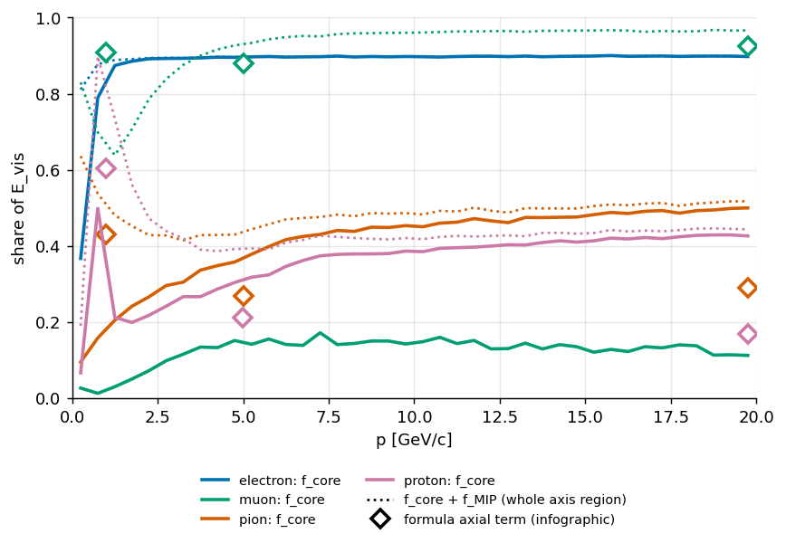
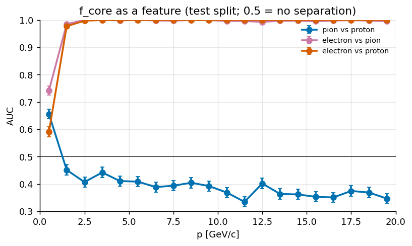

**English** | [Magyar](Q2.hu.md)

# Q2 – Is the core fraction of protons really ~60 % at 1 GeV/c, and ~43 % for pions?

Particle issue [#1](https://github.com/EgyipTomi425/particle/issues/1). Notebook: [`notebooks/09_axis_core.ipynb`](../../notebooks/09_axis_core.ipynb).

**Answer. No.** Measured with the definition of issue #1, the core fraction at 1 GeV/c is **f_core = 0.40 ± 0.01
for protons and 0.19 ± 0.01 for pions** (ratio of sums; event means 0.33 and
0.18). The infographic numbers (0.61 and 0.43) are not a core fraction:
they are the share of the *axial term* of the fitted shape formula, the model's component for the primary's whole passage. The measured
counterpart of that is the whole axis region `f_core + f_MIP` = 0.87 (proton) and 0.51 (pion), or
the primary's own share of `E_vis` in the simulation truth, 0.68 and 0.25. For the proton the
axial term (0.61) is close to that truth (0.68); for the pion it is too large
(0.43 against 0.25): the fit gives the axial term energy of secondaries near the axis.

| particle | p [GeV/c] | f_core (ratio of sums) | f_core (event mean) | f_MIP | f_core + f_MIP | infographic (axial term) | truth: primary's share | truth: f_core from the primary's passage | truth: interaction before tile 1 / inelastic / stops |
|---|---|---|---|---|---|---|---|---|---|
| electron | 1 | 0.85 ± 0.01 | 0.83 | 0.04 | 0.89 | 0.00 | 0.05 | 0.04 | 59 % / 0 % / 41 % |
| electron | 5 | 0.90 ± 0.00 | 0.89 | 0.00 | 0.90 | 0.00 | 0.01 | 0.01 | 69 % / 0 % / 31 % |
| electron | 20 | 0.90 ± 0.00 | 0.90 | 0.00 | 0.90 | 0.00 | 0.00 | 0.00 | 78 % / 0 % / 22 % |
| muon | 1 | 0.02 ± 0.00 | 0.02 | 0.65 | 0.67 | 0.91 | 0.93 | 0.02 | 0 % / 51 % / 49 % |
| muon | 5 | 0.15 ± 0.01 | 0.12 | 0.78 | 0.93 | 0.88 | 0.81 | 0.10 | 0 % / 0 % / 14 % |
| muon | 20 | 0.11 ± 0.01 | 0.06 | 0.85 | 0.97 | 0.93 | 0.74 | 0.04 | 0 % / 0 % / 15 % |
| pion | 1 | 0.19 ± 0.01 | 0.18 | 0.32 | 0.51 | 0.43 | 0.25 | 0.03 | 29 % / 69 % / 0 % |
| pion | 5 | 0.37 ± 0.00 | 0.36 | 0.07 | 0.44 | 0.27 | 0.06 | 0.02 | 22 % / 78 % / 0 % |
| pion | 20 | 0.50 ± 0.00 | 0.49 | 0.02 | 0.52 | 0.29 | 0.02 | 0.00 | 22 % / 78 % / 0 % |
| proton | 1 | 0.40 ± 0.01 | 0.33 | 0.47 | 0.87 | 0.61 | 0.68 | 0.26 | 25 % / 35 % / 40 % |
| proton | 5 | 0.31 ± 0.00 | 0.31 | 0.08 | 0.40 | 0.21 | 0.07 | 0.02 | 26 % / 74 % / 0 % |
| proton | 20 | 0.43 ± 0.00 | 0.42 | 0.02 | 0.44 | 0.17 | 0.02 | 0.01 | 25 % / 75 % / 0 % |

Windows: 0.9–1.1, 4.75–5.25 and 19.5–20 GeV/c. Halving the window width changes f_core by less than its error (`q2_table.csv`).

**How much comes from an initial non-interacting passage?** At 1 GeV/c 40 % of the protons stop without a hadronic
interaction (their range is about 16 cm of steel), 25 % interact in the 40.4 mm front steel and
35 % later. **0.26 of the proton's 0.40 core is the proton's own
deposit after its MIP segment** (the heavily ionising end of the range, more than 2 MIP per tile, where the finder ends the MIP segment);
for stopping protons f_core is 0.45, for interacting ones 0.35. For pions only
0.03 of 0.19 comes from the pion itself: 98 %
of them interact, so the pion core is shower. At 5 and 20 GeV/c the primary's own passage gives at most 0.02 for both. Pions and protons
reach at least the second tile in about two thirds of the events (`truth_reaches_tile2` in `q2_table.csv`).

**Discriminating power.** The core fraction separates pions from protons weakly but clearly: AUC = 0.55 (1–2 GeV/c), 0.61 (9–10)
and 0.65 (19–20 GeV/c) – protons have less core than pions above 1 GeV/c (below 1 GeV/c the stopping protons have more). The
ratio core / rest of the shower is a monotonic function of f_core and has the same AUC. Against electrons f_core is the strongest single
feature (see Q3: about 99 % hadron efficiency at 99 % electron rejection from 2 GeV/c).

**To confirm with Gábor.** *Event mean or ratio of sums?* Both are in the table; they differ by up to 0.07 for 1 GeV/c protons (a few
high-energy events dominate the sum). The infographic, being a model of the mean density, corresponds to the ratio of sums.
