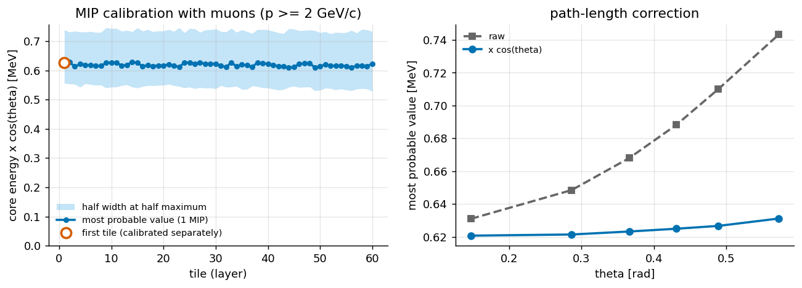
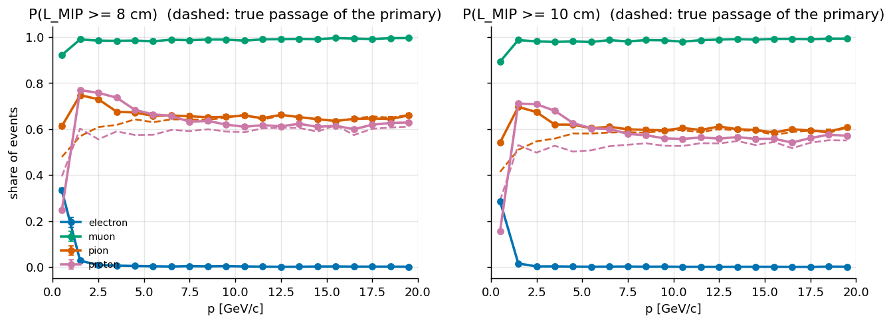
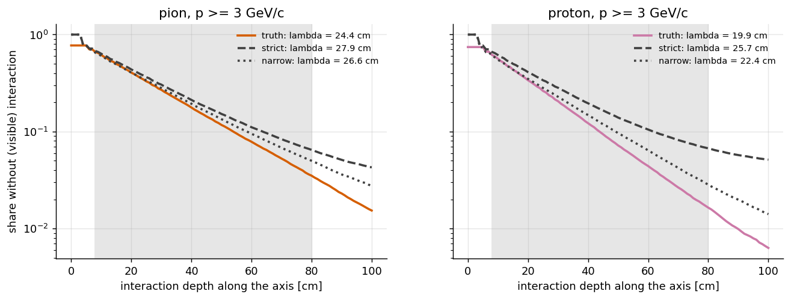
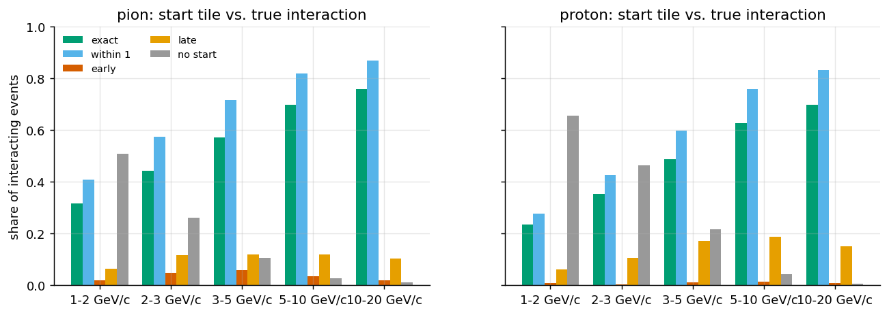
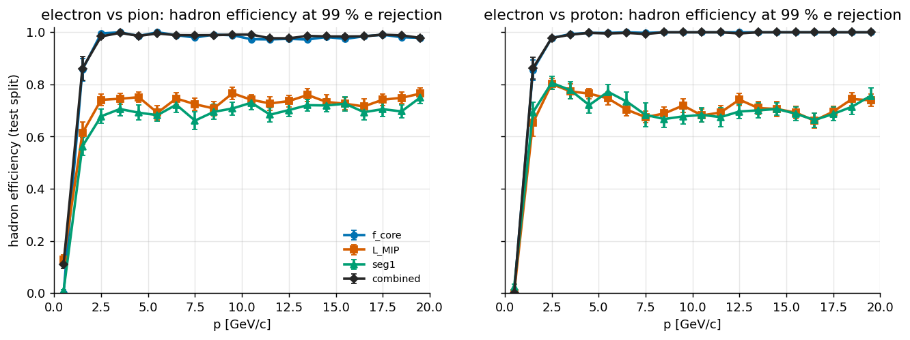

[English](Q3.md) | **Magyar**

# Q3 – Van-e MIP-szakasz a hadronzáporok elején, és mennyire jól azonosítja a hadronokat?

Részecske-issue [#1](https://github.com/EgyipTomi425/particle/issues/1). Notebook: [`notebooks/10_mip_segment.ipynb`](../../notebooks/10_mip_segment.ipynb).

**Válasz.** Igen: a pionok és protonok 75 %–89 %-a MIP-szakasszal kezd; a többi nagyrészt már az
első csempe előtti 40,4 mm acélban kölcsönhat. A legalább 8 cm-es szakasz nagy tisztaságú hadronjel – a hadronok
62 %–77 %-ánál és az elektronok 2,7 % (1–2 GeV/c) – 0,1 %
(10–20 GeV/c) részénél fordul elő, a valószínűségi hányados 27–471 –, de 99 % elektron-elutasításnál a hadronoknak
csak kb. 60–80 %-át tartja meg, mert a többi korábban kölcsönhat. Az elektron–hadron szétválasztásban a magarány az erősebb (2 GeV/c-től
kb. 99 %); a MIP-szakasz a piont a protontól nem választja el. Az issue szabályán változtatni kellett, hogy a zápor kezdete megbízható
legyen (lásd *A kereső*).

## Gábor négy állítása

1. **Lehet, hogy ott van, lehet, hogy nincs – igaz.** A hadronesemények 75 %–89 %-ában van
   szakasz; a szimulációs igazság szerint a primerek 71 %–78 %-a eléri az első csempét (a többi
   az elülső acélban hat kölcsön, kb. 1 − exp(−4,04 cm / (λ cos θ)); kis impulzusnál e kölcsönhatások egy része nem látszik, ezért ott a
   megfigyelt arány nagyobb).
2. **Ha ott van, mindig a belépési pontnál kezdődik – a primerre igaz.** A primer szakasza definíció szerint a belépésnél kezdődik; a zápor
   kezdete után viszont egy másodlagos részecske (egy lágy kölcsönhatás vezető hadronja) 3–20 GeV/c-n az események
   9 %–13 %-ában újabb, legalább 4 csempés MIP-szerű szakaszt húz (igazság: másodlagos viszi; maga a
   primer legfeljebb 1,2 %-ban). Ezek a későbbi szakaszok nem a belépési pontnál kezdődnek.
3. **Nagyon kis energialerakódás, csak a tengely mentén – a primerre igaz, a csempékre nem.** Azokban a csempékben, amelyeket a primer a
   kölcsönhatása előtt átszel (igazság, p ≥ 3 GeV/c), a magban pionnál 1,45 MIP van csempénként, ebből
   1,14 MIP maga a pion, 0,31 MIP másodlagos; 5 cm-en
   kívül ugyanezek a csempék 0,60 MIP-et kapnak (proton 0,77),
   és 13 %-uk (17 %-uk)
   több mint 1 MIP-et, szemben a müonok 0,07 MIP-jével és 1,1 %-ával
   (náluk nincs hadronikus kölcsönhatás): ez a kaloriméterben mélyebben induló zápor **visszaszórása**. Az 5 cm-en kívüli energiára tett
   feltétel ezért túl korán zárja le a szakaszt.
4. **A 8–10 cm-es vagy hosszabb szakasz nagyon erős hadronjel – a tisztaságra igaz, a hatásfoka korlátozott** (számok fent és lent).

## MIP-kalibráció müonokkal

Müonok p ≥ 2 GeV/c-vel, minden csempe külön: a mag-energia × cos θ legvalószínűbb értéke 0,618 MeV (a 60 csempe
mediánja; az első csempe 0,626 MeV), a félértékszélesség felei 0,080 /
0,116 MeV. A nyers érték θ-val 0,631-ról 0,743 MeV-re nő
(18 %); az 1/cos θ korrekció után csak
1,7 %-ot változik, és ennek kb. fele várható, mert a legvalószínűbb
energiaveszteség kicsit gyorsabban nő, mint az úthossz (Landau–Vavilov, θ = 0,57 rad-nál ≈ 1 %). Ez egyezik a PDG
Landau–Vavilov-képlet szerinti legvalószínűbb értékkel az ePIC 4 mm-es polisztirol csempéjére (1,032 g/cm³): 0,615–0,624 MeV a
2–20 GeV/c-s müonokra. Az átszelt csempék kb.
7 %-ában nincs energia (rések a csempék között), ezért üres csempe nem zárhatja le a szakaszt.

## A kereső

Egy csempe **MIP-szerű**, ha a mag-energiája legfeljebb 2,0 MIP, és legfeljebb 2 cella tüzel (> 0,3 MIP). A
**zápor ott kezdődik**, ahol először 2 egymást követő nem MIP-szerű csempe mag-energiájának összege meghaladja a **6 + 0,5 · p[GeV/c] MIP**-et
(az impulzus a nyomkövetőből ismert; a CMS HGCAL is energiafüggő küszöböket használ). Üres csempe nem szakítja meg a szakaszt; kezdet
nélkül a szakasz a tengely menti utolsó lerakódásnál ér véget (megálló részecske). `L_MIP` a kezdet előtti utolsó, tengely menti
lerakódású csempe mélysége, `z_start` a kezdő csempéé. Mivel a csempe az elnyelője előtt ül, L_MIP ≤ a valódi kölcsönhatás mélysége < z_start.

A paramétereket a tanító mintán, a szimulációs igazsághoz mérve választottuk (`scripts/core_mip_tune.py`, 864 beállítás): a legfeljebb 3 %
müon-hamis-kezdetet adó (λ_I-nként; CALICE Si-W szint) beállítások közül a legjobb ±1 csempés egyezéstől 0,01-en belüliek, ezek közül a
legjobb L_MIP-hatásfok 99 % elektron-elutasításnál. Összehasonlítás a tanító mintán:

| szabály | ±1 csempés egyezés (π, p; 3–20 GeV/c) | korai kezdet (π) | késői kezdet (π) | müon hamis kezdet λ_I-nként | π hatásfok 99 % e-elutasításnál, 1–3 / 3–20 GeV/c |
|---|---|---|---|---|---|
| választott | 0,77 | 3 % | 11 % | 2,8 % | 0,71 / 0,72 |
| az issue szabálya (2,5 MIP-sáv, energiafeltétel nélkül) | 0,66 | 25 % | 9 % | 9,9 % | 0,59 / 0,65 |
| keskeny lerakódás | 0,60 | 18 % | 19 % | 0,9 % | 0,13 / 0,39 |

Az issue szabálya a pionesemények negyedében túl korán indítja a záport: az 5 cm-en kívüli energia és a cellaszám a visszaszórásra
reagál, és egyetlen Landau-/δ-sugaras csempepár is elég. A mag-energiára tett feltétel ezt megszünteti. **Szigorú sáv vagy keskeny
lerakódás a lassú hadronokra?** A keskeny változat (a mag-energiára nincs korlát) nem tudja megkülönböztetni az elektronzáport a lassú
hadrontól – mindkettő keskeny –, így azonosításra alkalmatlan (pionhatásfok 1–3 GeV/c-n: 0,13); az
energiafeltétellel a szigorú sáv a lassú protonokat a hatótávolságuk végéig a szakaszban tartja. A szigorú változatot javasoljuk.

## L_MIP és P(L_MIP ≥ 8 / 10 cm)

P(L ≥ 8 cm) / P(L ≥ 10 cm):

| részecske | 1–2 GeV/c | 2–3 | 3–5 | 5–10 | 10–20 |
|---|---|---|---|---|---|
| elektron | 0,03 / 0,02 | 0,01 / 0,00 | 0,00 / 0,00 | 0,00 / 0,00 | 0,00 / 0,00 |
| müon | 0,99 / 0,99 | 0,99 / 0,98 | 0,98 / 0,98 | 0,99 / 0,98 | 0,99 / 0,99 |
| pion | 0,75 / 0,70 | 0,73 / 0,67 | 0,67 / 0,62 | 0,66 / 0,60 | 0,65 / 0,60 |
| proton | 0,77 / 0,71 | 0,76 / 0,71 | 0,71 / 0,65 | 0,64 / 0,58 | 0,62 / 0,56 |

## Effektív kölcsönhatási hossz

Csonkolt, cenzorált exponenciális likelihood 8–80 cm-en, p ≥ 3 GeV/c:

- **szimulációs igazság** (a primer utolsó csempéje): **λ = 24,4 ± 0,1 cm a pionra és
  19,9 ± 0,1 cm a protonra**, arányuk 1,23. A rétegszerkezet PDG-értékei,
  26,0 és 21,2 cm (arány 1,23), 200 GeV/c-re vonatkoznak; a pionérték az impulzussal nő (22,7 cm
  3–5, 25,0 cm 10–20 GeV/c-n), a protoné állandó
  (19,1 / 20,2 cm). Az igazság túlélése tiszta exponenciális.
- **a kereső** az első *látható* zápor-kezdetet méri: λ_eff = 27,9 cm (pion) és 25,7 cm (proton), a
  túlélése nem egyetlen exponenciális. Azért hosszabb az igazságnál, mert a kölcsönhatások egy része kevés energiát ad le a tengely
  közelében: a valódi kölcsönhatás utáni két csempe a pionkölcsönhatások 56 % / 40 % / 26 % / 17 % / 15 %, a protonkölcsönhatások 67 % / 53 % / 39 % / 26 % / 19 % részében kevesebbet tartalmaz
  a kezdési küszöbnél (1–2, 2–3, 3–5, 5–10, 10–20 GeV/c). A müonok hamis kezdetei (16 %, λ_fake =
  697 cm) kicsit rövidítik. Az effektív hossz tehát a kezdet definíciójától függ; a fizikai kölcsönhatási hossz az
  igazság szerinti érték.

## A kezdő csempe a valódi kölcsönhatáshoz képest

A valódi kölcsönhatástól legfeljebb ±1 csempére lévő kezdetek aránya (korai / késői / nincs kezdet), minden esemény:

| részecske | 1–2 GeV/c | 2–3 | 3–5 | 5–10 | 10–20 |
|---|---|---|---|---|---|
| pion | 0,41 (0,02 / 0,06 / 0,51) | 0,57 (0,05 / 0,12 / 0,26) | 0,72 (0,06 / 0,12 / 0,11) | 0,82 (0,04 / 0,12 / 0,03) | 0,87 (0,02 / 0,10 / 0,01) |
| proton | 0,28 (0,01 / 0,06 / 0,66) | 0,43 (0,00 / 0,11 / 0,46) | 0,60 (0,01 / 0,17 / 0,22) | 0,76 (0,01 / 0,19 / 0,04) | 0,83 (0,01 / 0,15 / 0,01) |

5 GeV/c-től az egyezés (0,76–0,87) a CALICE-keresők szintjén van (10–80 GeV-en kb. 80 % ±1 rétegen belül); 3 GeV/c alatt sok
kölcsönhatás nem látszik zápor-kezdetként (kis multiplicitás, az energiát neutronok viszik), ott a MIP-szakasz az első *látható*
aktivitásig tart.

## Hadronazonosítás

Hadronhatásfok 99 % elektron-elutasításnál (tesztminta; a küszöbök a tanító és a validációs elektronokból):

| hadron | jellemző | 1–2 GeV/c | 2–3 | 4–5 | 9–10 | 19–20 |
|---|---|---|---|---|---|---|
| pion | f_core | 0,86 | 1,00 | 0,99 | 0,99 | 0,98 |
| pion | L_MIP | 0,61 | 0,74 | 0,75 | 0,77 | 0,76 |
| pion | seg1 | 0,56 | 0,68 | 0,69 | 0,71 | 0,75 |
| pion | combined | 0,86 | 0,98 | 0,99 | 0,99 | 0,98 |
| proton | f_core | 0,86 | 0,98 | 1,00 | 1,00 | 1,00 |
| proton | L_MIP | 0,65 | 0,80 | 0,76 | 0,72 | 0,74 |
| proton | seg1 | 0,69 | 0,81 | 0,72 | 0,68 | 0,76 |
| proton | combined | 0,86 | 0,98 | 1,00 | 1,00 | 1,00 |

A `seg1` az 1–5. csempe energiája. **Az ePIC LFHCal ezt az öt csempét egy csatornán olvassa ki** (5, 5, 10, 10, 10, 10, 10 csempés
szegmensek), így a csempénkénti L_MIP csak a szimulációban (és az egyenként kiolvasott betétben) létezik; a kiolvasás szintjén a jel úgy
szól: „az első szegmens MIP-szerű”, és ez majdnem ugyanazt a hatásfokot adja. 1 GeV/c alatt semmi sem működik (a lágy elektronok csak
néhány MeV-et adnak le).

## Ellenőrzések

A független második minta (s2; ugyanaz a kereső, saját MIP-kalibráció) a 258 összevetett számot a statisztikai hibán belül megismétli (98 % 2σ-n belül, a legnagyobb eltérés 2,9σ; `s2_check.csv`); a MIP-kalibráció csempénként mediánban 0,3 %-ra egyezik. A definíciókból írt második implementáció (`scripts/verify_core_mip.py`) eseményenként megismétli az igazságot,
a kereső kezdő csempéjét és a fő számokat (`verification.csv`).

## Hivatkozások

- CALICE, *Pion and proton showers in the CALICE scintillator-steel analogue hadron calorimeter*, JINST 10 (2015) P04014,
  [arXiv:1412.2653](https://arxiv.org/abs/1412.2653) – shower-start finder, truth from the primary's inelastic interaction.
- CALICE, *Testing hadronic interaction models using a highly granular silicon-tungsten calorimeter*, NIM A 794 (2015) 240,
  [arXiv:1411.7215](https://arxiv.org/abs/1411.7215) – interaction-layer finder, muon false starts per interaction length.
- CMS HGCAL and CALICE, *Performance of the CMS High Granularity Calorimeter prototype to charged pion beams of 20–300 GeV/c*,
  JINST 18 (2023) P08014, [arXiv:2211.04740](https://arxiv.org/abs/2211.04740) – energy-dependent shower-start thresholds, λ_π / λ_I ≈ 1.2.
- CALICE, *Particle identification using Boosted Decision Trees in the Semi-Digital Hadronic Calorimeter prototype*, JINST 15 (2020)
  P10009, [arXiv:2004.02972](https://arxiv.org/abs/2004.02972) – shower start and radius as e/π features.
- Particle Data Group, *Passage of particles through matter* (2024) and *Atomic and nuclear properties of materials* – MIP energy loss,
  most probable value, interaction lengths.
- ePIC geometry, [eic/epic `compact/hcal/lfhcal.xml`](https://github.com/eic/epic/blob/main/compact/hcal/lfhcal.xml) (tag 26.08.0):
  tile in front of its absorber, 25.4 mm + 15 mm front steel, readout segments of 5, 5, 10, 10, 10, 10, 10 tiles (`rlayerz`).
