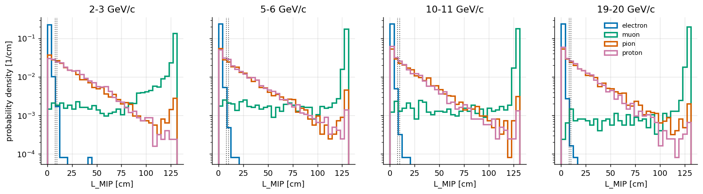

[English](Q3.md) | **Magyar**

# Q3 – Van-e MIP-szakasz a hadronzáporok elején, és mennyire jól azonosítja a hadronokat?

Részecske-issue [#1](https://github.com/EgyipTomi425/particle/issues/1). Notebook: [`notebooks/10_mip_segment.ipynb`](../../notebooks/10_mip_segment.ipynb).

**Honnan jönnek a számok.** Minden szám az ePIC LFHCal szimulációjából (Geant4, FTFP_BERT) származik. A jelöletlen számokat a
szimulált találati energiákból számoltuk, ahogy a detektor rögzítené őket (zaj nélkül, csempénként). Az *(igazság)* jelű számok
olyan információt használnak, amit egy valódi detektor nem ad: melyik részecske adott le elsőként energiát egy cellában, és hogyan
ért véget a primer részecske nyoma (a leányrészecskéiből). A becsléseket és az irodalmi értékeket külön megnevezzük.

**Válasz.** A pion- és protonesemények 75 %–89 %-ában találunk MIP-szakaszt. Legalább 8 cm-es
szakasz a hadronok 62 %–77 %-ánál és az elektronok 2,7 % (1–2 GeV/c) –
0,1 % (10–20 GeV/c) részénél fordul elő (valószínűségi hányados 27–471). 99 %
elektron-elutasításnál 2 GeV/c-től az L_MIP a hadronok 66 %–80 %-át tartja meg, az f_core 97 %–100 %-át.
Pion–proton szétválasztás L_MIP-pel: AUC 0,45–0,53 (1–20 GeV/c). Az issue kezdetszabályán
változtattunk (lásd *A kereső*).

## Gábor négy állítása

1. **Lehet, hogy ott van, lehet, hogy nincs.** A hadronesemények 75 %–89 %-ában
   találunk szakaszt. *(igazság)* Az események 71 %–78 %-ában a primer maga is szerepel legalább
   egy csempében; a többiben egyetlen cellában sem ő az első részecske (a pionok 22 %–28 %-a, a protonok
   25 %–29 %-a, 1–20 GeV/c), ezt az első csempe előtti 40,4 mm acélban történt kölcsönhatásnak számoljuk.
   Összehasonlításképpen az 1 − exp(−4,04 cm / (λ cos θ)) a vas kölcsönhatási hosszaival (PDG: pionra 20,4 cm, protonra 16,8 cm) és a
   szimulált szögekkel 19 % és 23 % (`scripts/core_mip_estimates.py`).
2. **Ha ott van, mindig a belépési pontnál kezdődik.** A kereső a szakaszt definíció szerint a belépési pontnál kezdi. A zápor kezdete
   után 3–20 GeV/c-n az események 9 %–13 %-ában további, legalább 4 csempés MIP-szerű szakaszt
   találunk, amelynek mag-energiájából legfeljebb a fele van olyan cellákban, amelyekben a primer az első részecske *(igazság)*; a
   több mint felet tartalmazó ilyen szakaszok az események legfeljebb 1,2 %-ában fordulnak elő. Ezek a későbbi szakaszok nem a belépési pontnál kezdődnek.
3. **Nagyon kis energialerakódás, csak a tengely mentén.** *(igazság, p ≥ 3 GeV/c)* A primer által a kölcsönhatása előtt átszelt
   csempékben a mag pionnál 1,45 MIP-et tartalmaz csempénként: 1,14 MIP-et
   a pion saját celláiban, 0,31 MIP-et másodlagos részecskék celláiban. 5 cm-en kívül ugyanezek a
   csempék csempénként 0,60 MIP-et kapnak (proton 0,77), és
   13 %-uk (17 %-uk) több mint
   1 MIP-et; a müoncsempékre ugyanezek 0,07 MIP és 1,1 %. Az issue
   5 cm-en kívüli energiára tett küszöbével a kezdet a pionesemények 25 %-ában több mint egy csempével
   a valódi kölcsönhatás előtt van (tanító minta; lásd *A kereső*).
4. **A 8–10 cm-es vagy hosszabb szakasz nagyon erős hadronjel.** L_MIP ≥ 8 cm: a hadronok 62 %–77 %-a,
   az elektronok 0,1 %–2,7 %-a; hatásfokok 99 % elektron-elutasításnál: lásd *Hadronazonosítás*.

## MIP-kalibráció müonokkal

Müonok p ≥ 2 GeV/c-vel, minden csempe külön: a mag-energia × cos θ legvalószínűbb értéke 0,618 MeV (a 60 csempe
mediánja; az első csempe 0,626 MeV), a félértékszélesség felei 0,080 /
0,116 MeV. A nyers érték θ-val 0,631-ról 0,743 MeV-re nő
(18 %); az 1/cos θ korrekció után
1,7 %-ot változik; összehasonlításképpen a PDG Landau–Vavilov-képlete szerint
θ = 0,57 rad-nál az 1/cos θ-szor hosszabb úton a legvalószínűbb érték ≈ 1 %-kal nagyobb az úthosszal arányosnál. Összehasonlításképpen a PDG
Landau–Vavilov-képlet szerinti legvalószínűbb érték az ePIC 4 mm-es polisztirol csempéjére (1,032 g/cm³): 0,615–0,624 MeV a
2–20 GeV/c-s müonokra. Az átszelt csempék kb.
7 %-ában nincs mag-energia; a keresőben üres csempe nem zárja le a szakaszt.

## A kereső

Egy csempe **MIP-szerű**, ha a mag-energiája legfeljebb 2,0 MIP, és legfeljebb 2 cella tüzel (> 0,3 MIP). A
**zápor ott kezdődik**, ahol először 2 egymást követő nem MIP-szerű csempe mag-energiájának összege meghaladja a **6 + 0,5 · p[GeV/c] MIP**-et
(p a beérkező impulzus). Üres csempe nem szakítja meg a szakaszt; kezdet
nélkül a szakasz a tengely menti utolsó lerakódásnál ér véget (megálló részecske). `L_MIP` a kezdet előtti utolsó, tengely menti
lerakódású csempe mélysége, `z_start` a kezdő csempéé. Minden csempe az elnyelőlemeze előtt ül, így jó csempében talált kezdetnél L_MIP ≤ a valódi kölcsönhatás mélysége < z_start.

A paramétereket a tanító mintán, a szimulációs igazsághoz mérve választottuk (`scripts/core_mip_tune.py`, 864 beállítás): a legfeljebb 3 %
müon-hamis-kezdetet adó (λ_I-nként) beállítások közül a legjobb ±1 csempés egyezéstől 0,01-en belüliek, ezek közül a
legjobb L_MIP-hatásfok 99 % elektron-elutasításnál. Összehasonlítás a tanító mintán:

| szabály | ±1 csempés egyezés (π, p; 3–20 GeV/c) | korai kezdet (π) | késői kezdet (π) | müon hamis kezdet λ_I-nként | π hatásfok 99 % e-elutasításnál, 1–3 / 3–20 GeV/c |
|---|---|---|---|---|---|
| választott | 0,77 | 3 % | 11 % | 2,8 % | 0,71 / 0,72 |
| az issue szabálya (2,5 MIP-sáv, energiafeltétel nélkül) | 0,66 | 25 % | 9 % | 9,9 % | 0,59 / 0,65 |
| keskeny lerakódás | 0,60 | 18 % | 19 % | 0,9 % | 0,13 / 0,39 |

Az issue szabályával a kezdet a pionesemények 25 %-ában korai (több mint egy csempével a
valódi kölcsönhatás előtt), a választott szabállyal 3 %-ában (táblázat). **Szigorú sáv vagy keskeny
lerakódás a lassú hadronokra?** Pionhatásfok 99 % elektron-elutasításnál, 1–3 GeV/c: keskeny lerakódás 0,13,
szigorú sáv 0,71 (táblázat). Mindkét változat el van mentve (`*_strict`, `*_narrow` a
`results/features/<particle>.parquet`-ban); ezeken az oldalakon a számok a szigorú sávval készültek.

## L_MIP és P(L_MIP ≥ 8 / 10 cm)

P(L ≥ 8 cm) / P(L ≥ 10 cm):

| részecske | 1–2 GeV/c | 2–3 | 3–5 | 5–10 | 10–20 |
|---|---|---|---|---|---|
| elektron | 0,03 / 0,02 | 0,01 / 0,00 | 0,00 / 0,00 | 0,00 / 0,00 | 0,00 / 0,00 |
| müon | 0,99 / 0,99 | 0,99 / 0,98 | 0,98 / 0,98 | 0,99 / 0,98 | 0,99 / 0,99 |
| pion | 0,75 / 0,70 | 0,73 / 0,67 | 0,67 / 0,62 | 0,66 / 0,60 | 0,65 / 0,60 |
| proton | 0,77 / 0,71 | 0,76 / 0,71 | 0,71 / 0,65 | 0,64 / 0,58 | 0,62 / 0,56 |

## Effektív kölcsönhatási hossz

Csonkolt, cenzorált exponenciális likelihood 8–80 cm-en, p ≥ 3 GeV/c:

- **szimulációs igazság** (a primer utolsó csempéje): **λ = 24,4 ± 0,1 cm a pionra és
  19,9 ± 0,1 cm a protonra**, arányuk 1,23. A rétegszerkezet PDG-értékei,
  26,0 és 21,2 cm (arány 1,23), 200 GeV/c-re vonatkoznak. Impulzus szerint: pion 22,7 cm 3–5 és
  25,0 cm 10–20 GeV/c-n, proton 19,1 és
  20,2 cm.
- **a kereső kezdő csempéje:** λ_eff = 27,9 cm (pion) és 25,7 cm (proton), *(igazság)* a
  pionkölcsönhatások 56 % / 40 % / 26 % / 17 % / 15 %, a protonkölcsönhatások 67 % / 53 % / 39 % / 26 % / 19 % részében a valódi kölcsönhatás utáni két csempe kevesebb mag-energiát tartalmaz a
  kezdési küszöbnél (1–2, 2–3, 3–5, 5–10, 10–20 GeV/c). Müonok hamis kezdetei: a müonok 16 %-a,
  λ_fake = 697 cm.

## A kezdő csempe a valódi kölcsönhatáshoz képest

A valódi kölcsönhatástól legfeljebb ±1 csempére lévő kezdetek aránya (korai / késői / nincs kezdet), minden esemény:

| részecske | 1–2 GeV/c | 2–3 | 3–5 | 5–10 | 10–20 |
|---|---|---|---|---|---|
| pion | 0,41 (0,02 / 0,06 / 0,51) | 0,57 (0,05 / 0,12 / 0,26) | 0,72 (0,06 / 0,12 / 0,11) | 0,82 (0,04 / 0,12 / 0,03) | 0,87 (0,02 / 0,10 / 0,01) |
| proton | 0,28 (0,01 / 0,06 / 0,66) | 0,43 (0,00 / 0,11 / 0,46) | 0,60 (0,01 / 0,17 / 0,22) | 0,76 (0,01 / 0,19 / 0,04) | 0,83 (0,01 / 0,15 / 0,01) |

±1 csempén belüli egyezés 5 GeV/c-től: 0,76–0,87; 3 GeV/c alatt kisebb (táblázat).

## Hadronazonosítás

Hadronhatásfok 99 % elektron-elutasításnál (tesztminta; a küszöbök a tanító és a validációs elektronokból):

| hadron | jellemző | 1–2 GeV/c | 2–3 | 4–5 | 9–10 | 19–20 |
|---|---|---|---|---|---|---|
| pion | f_core | 0,86 | 1,00 | 0,99 | 0,99 | 0,98 |
| pion | L_MIP | 0,61 | 0,74 | 0,75 | 0,77 | 0,76 |
| pion | seg1 | 0,56 | 0,68 | 0,69 | 0,71 | 0,75 |
| pion | combined | 0,86 | 0,98 | 0,99 | 0,99 | 0,98 |
| proton | f_core | 0,86 | 0,98 | 1,00 | 1,00 | 1,00 |
| proton | L_MIP | 0,65 | 0,80 | 0,76 | 0,72 | 0,74 |
| proton | seg1 | 0,69 | 0,81 | 0,72 | 0,68 | 0,76 |
| proton | combined | 0,86 | 0,98 | 1,00 | 1,00 | 1,00 |

A `seg1` az 1–5. csempe energiája. **Az ePIC LFHCal ezt az öt csempét egy csatornán olvassa ki** (5, 5, 10, 10, 10, 10, 10 csempés
szegmensek), így a csempénkénti L_MIP csak a szimulációban létezik; a kiolvasás szintjén a jel úgy szól: „az első szegmens MIP-szerű”
(a táblázat `seg1` sora).

## Ellenőrzések

Független második minta (s2; ugyanaz a kereső, saját MIP-kalibráció): 258 összevetett szám, ebből 98 % 2σ-n belül, a legnagyobb eltérés 2,9σ (`s2_check.csv`); a MIP-kalibráció csempénkénti eltérésének mediánja 0,3 %. A definíciókból írt második implementáció (`scripts/verify_core_mip.py`) eseményenként megismétli az igazságot,
a kereső kezdő csempéjét és a fő számokat (`verification.csv`).

## Hivatkozások

- CALICE, *Pion and proton showers in the CALICE scintillator-steel analogue hadron calorimeter*, JINST 10 (2015) P04014,
  [arXiv:1412.2653](https://arxiv.org/abs/1412.2653) – shower-start finder, truth from the primary's inelastic interaction.
- CALICE, *Testing hadronic interaction models using a highly granular silicon-tungsten calorimeter*, NIM A 794 (2015) 240,
  [arXiv:1411.7215](https://arxiv.org/abs/1411.7215) – interaction-layer finder, muon false starts per interaction length.
- CMS HGCAL and CALICE, *Performance of the CMS High Granularity Calorimeter prototype to charged pion beams of 20–300 GeV/c*,
  JINST 18 (2023) P08014, [arXiv:2211.04740](https://arxiv.org/abs/2211.04740) – shower start in a high-granularity calorimeter prototype.
- CALICE, *Particle identification using Boosted Decision Trees in the Semi-Digital Hadronic Calorimeter prototype*, JINST 15 (2020)
  P10009, [arXiv:2004.02972](https://arxiv.org/abs/2004.02972) – shower start and radius as e/π features.
- Particle Data Group, *Passage of particles through matter* (2024) and *Atomic and nuclear properties of materials* – MIP energy loss,
  most probable value, interaction lengths.
- ePIC geometry, [eic/epic `compact/hcal/lfhcal.xml`](https://github.com/eic/epic/blob/main/compact/hcal/lfhcal.xml) (tag 26.08.0):
  tile in front of its absorber, 25.4 mm + 15 mm front steel, readout segments of 5, 5, 10, 10, 10, 10, 10 tiles (`rlayerz`).
