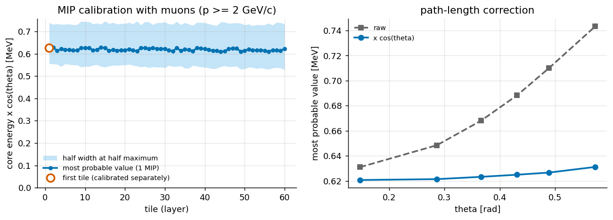
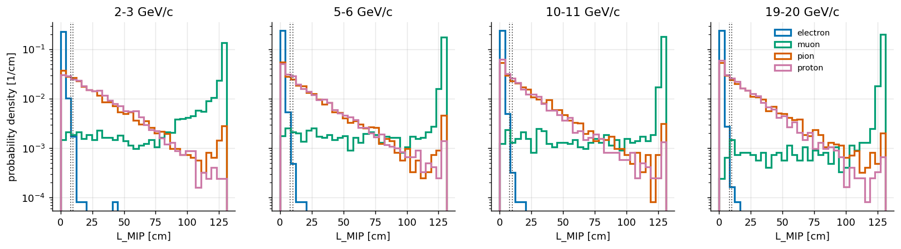
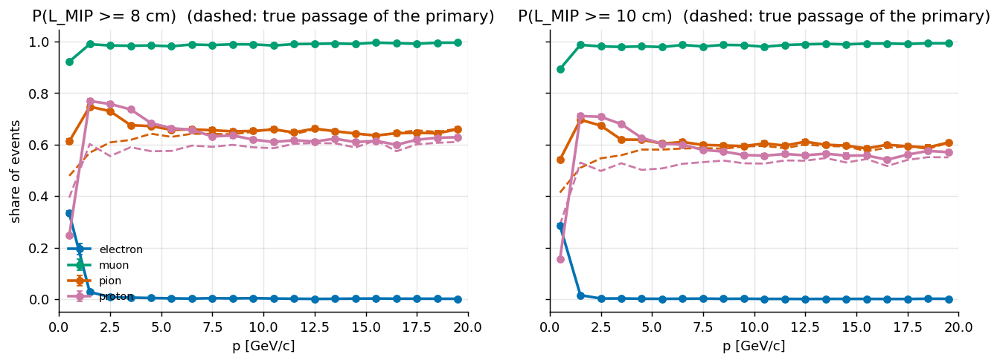
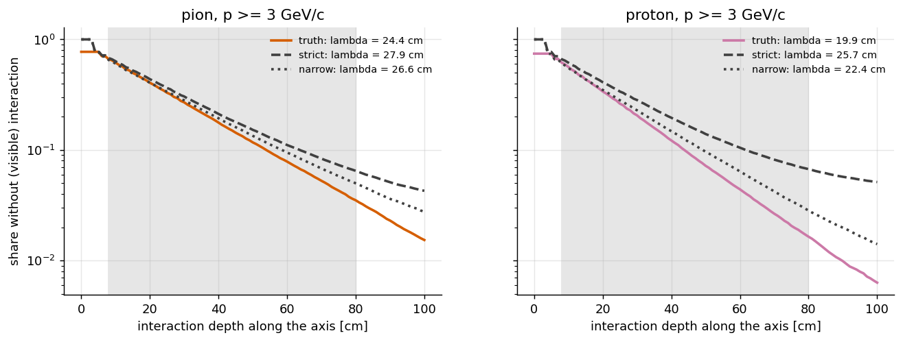
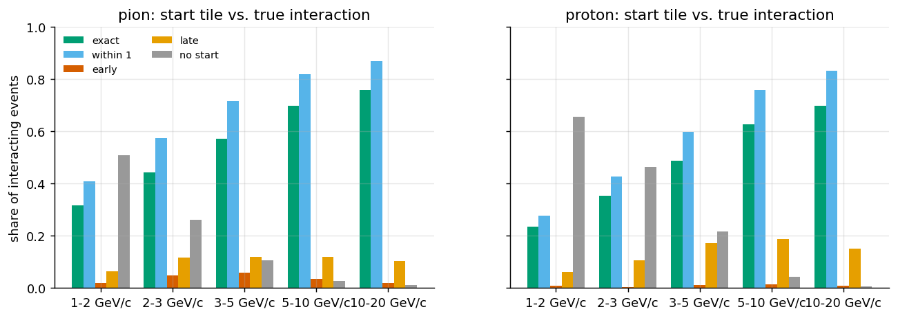
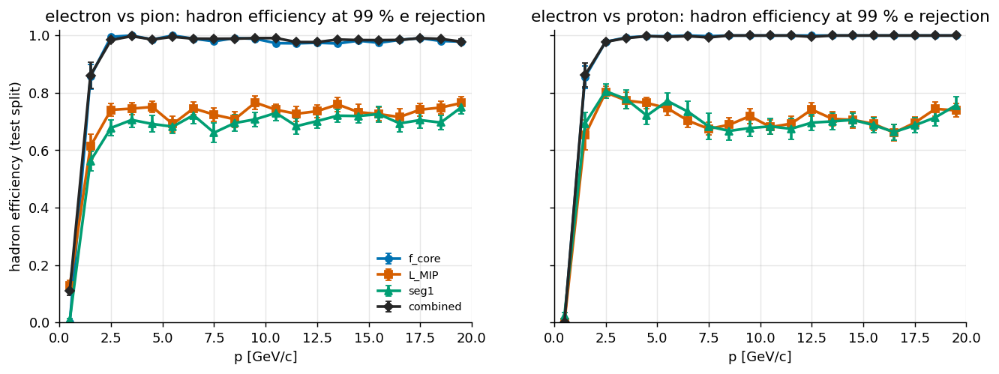

**English** | [Magyar](Q3.hu.md)

# Q3 – Is there a MIP segment at the start of hadron showers, and how well does it identify hadrons?

Particle issue [#1](https://github.com/EgyipTomi425/particle/issues/1). Notebook: [`notebooks/10_mip_segment.ipynb`](../../notebooks/10_mip_segment.ipynb).

**How the numbers were obtained.** All numbers come from the ePIC LFHCal simulation (Geant4, FTFP_BERT). Unmarked numbers are
computed from the simulated hit energies, as the detector would record them (noise-free, tile by tile). Numbers marked *(truth)*
use information that a real detector does not provide: which particle deposited energy first in a cell, and how the primary
particle's track ended (read from its daughter particles). Estimates and literature values are named as such.

**Answer.** A MIP segment is found in 75 %–89 % of the pion and proton events. A segment of
8 cm or longer occurs for 62 %–77 % of the hadrons and for 2.7 % (1–2 GeV/c) to 0.1 %
(10–20 GeV/c) of the electrons (likelihood ratio 27 to 471). At 99 % electron rejection, L_MIP keeps
66 %–80 % of the hadrons from 2 GeV/c and f_core 97 %–100 %. Pion/proton separation by L_MIP: AUC
0.45–0.53 (1–20 GeV/c). The start rule of the issue was changed (see *The finder*).

## Gábor's four properties

1. **It may or may not be there.** A segment is found in 75 %–89 % of the hadron events.
   *(truth)* In 71 %–78 % of the events the primary itself is recorded in at least one tile; in the others
   it is not the first particle in any cell (22 %–28 % of the pions, 25 %–29 % of the protons,
   1–20 GeV/c), which we count as an interaction in the 40.4 mm of steel in front of the first tile. For comparison,
   1 − exp(−4.04 cm / (λ cos θ)) with the interaction lengths of iron (PDG: 20.4 cm for pions, 16.8 cm for protons) and the simulated
   angles gives 19 % and 23 % (`scripts/core_mip_estimates.py`).
2. **If it is there, it always starts at the entry point.** The finder starts the segment at the entry point by construction. After
   the shower start a further MIP-like run of at least 4 tiles is found in 9 %–13 % of the events at
   3–20 GeV/c with at most half of the run's core energy in cells whose first particle is the primary *(truth)*; runs with more
   than half occur in at most 1.2 % of the events. Such later runs do not start at the entry point.
3. **Very small energy deposit, along the axis only.** *(truth, p ≥ 3 GeV/c)* In the tiles the primary crosses before its
   interaction, the core holds 1.45 MIP per tile for pions: 1.14 MIP in
   cells of the pion itself and 0.31 MIP in cells of secondary particles. Outside 5 cm the same
   tiles receive 0.60 MIP per tile (protons 0.77), and
   13 % (17 %) of them more than
   1 MIP; for muon tiles the same numbers are 0.07 MIP and 1.1 %.
   With the issue's threshold on the energy outside 5 cm, the start lies more than one tile before the truth interaction in
   25 % of the pion events (train split; see *The finder*).
4. **8–10 cm or longer is a very powerful hadron indicator.** L_MIP ≥ 8 cm: 62 %–77 % of the hadrons,
   0.1 %–2.7 % of the electrons; efficiencies at 99 % electron rejection: see *Hadron identification*.

## MIP calibration with muons

Muons with p ≥ 2 GeV/c, every tile on its own: most probable value of the core energy × cos θ = 0.618 MeV
(median of the 60 tiles; the first tile 0.626 MeV), half widths at half maximum 0.080 /
0.116 MeV. With θ the raw value rises from 0.631 to 0.743 MeV
(18 %); after the 1/cos θ correction it changes by
1.7 %; for comparison, the PDG Landau–Vavilov most probable value for the
1/cos θ longer path at θ = 0.57 rad is ≈ 1 % above path-length scaling.
For comparison, the PDG Landau–Vavilov most probable value for a 4 mm tile of the ePIC polystyrene (1.032 g/cm³): 0.615–0.624 MeV
for 2–20 GeV/c muons. About 7 % of the crossed
tiles have no core energy; in the finder an empty tile does not end the segment.

## The finder

A tile is **MIP-like** if its core energy is at most 2.0 MIP and at most 2 cells fire (> 0.3 MIP). The
**shower starts** at the first 2 consecutive non-MIP tiles whose summed core energy exceeds **6 + 0.5 · p[GeV/c] MIP** (p is the incoming
momentum). Empty tiles do not interrupt the segment; without a start the
segment ends at the last deposit on the axis (a stopping particle). `L_MIP` is the depth of the last tile with a deposit on the axis
before the start; `z_start` the depth of the start tile. Each tile sits in front of its absorber plate, so for a start found in
the right tile L_MIP ≤ true interaction depth < z_start.

The parameters were chosen on the train split against the simulation truth (`scripts/core_mip_tune.py`, 864 settings): among the
settings with at most 3 % muon false starts per interaction length, those within 0.01 of the best ±1-tile
agreement with the true interaction, then the best L_MIP efficiency at 99 % electron rejection. Comparison on the train split:

| rule | ±1-tile agreement (π, p; 3–20 GeV/c) | early starts (π) | late starts (π) | muon false starts per λ_I | π efficiency at 99 % e rejection, 1–3 / 3–20 GeV/c |
|---|---|---|---|---|---|
| chosen | 0.77 | 3 % | 11 % | 2.8 % | 0.71 / 0.72 |
| issue rule (2.5 MIP band, no energy condition) | 0.66 | 25 % | 9 % | 9.9 % | 0.59 / 0.65 |
| narrow deposit | 0.60 | 18 % | 19 % | 0.9 % | 0.13 / 0.39 |

With the issue's rule the start is early (more than one tile before the truth interaction) in
25 % of the pion events, with the chosen rule in 3 % (table).
**Strict band or narrow deposit for slow hadrons?** Pion efficiency at 99 % electron rejection, 1–3 GeV/c: narrow deposit
0.13, strict band 0.71 (table). Both versions are stored (`*_strict`,
`*_narrow` in `results/features/<particle>.parquet`); the numbers on these pages use the strict band.

## L_MIP and P(L_MIP ≥ 8 / 10 cm)

P(L ≥ 8 cm) / P(L ≥ 10 cm):

| particle | 1–2 GeV/c | 2–3 | 3–5 | 5–10 | 10–20 |
|---|---|---|---|---|---|
| electron | 0.03 / 0.02 | 0.01 / 0.00 | 0.00 / 0.00 | 0.00 / 0.00 | 0.00 / 0.00 |
| muon | 0.99 / 0.99 | 0.99 / 0.98 | 0.98 / 0.98 | 0.99 / 0.98 | 0.99 / 0.99 |
| pion | 0.75 / 0.70 | 0.73 / 0.67 | 0.67 / 0.62 | 0.66 / 0.60 | 0.65 / 0.60 |
| proton | 0.77 / 0.71 | 0.76 / 0.71 | 0.71 / 0.65 | 0.64 / 0.58 | 0.62 / 0.56 |

## Effective interaction length

Truncated, censored exponential likelihood on 8–80 cm, p ≥ 3 GeV/c:

- **simulation truth** (the primary's last tile): **λ = 24.4 ± 0.1 cm for pions and 19.9 ± 0.1 cm
  for protons**, ratio 1.23. The PDG values of the layer stack, 26.0 and 21.2 cm (ratio 1.23), are for
  200 GeV/c. By momentum: pions 22.7 cm at 3–5 and 25.0 cm at 10–20 GeV/c,
  protons 19.1 and 20.2 cm.
- **the finder's start tile:** λ_eff = 27.9 cm (pions) and 25.7 cm
  (protons). *(truth)* In 56 % / 40 % / 26 % / 17 % / 15 % of the pion and 67 % / 53 % / 39 % / 26 % / 19 % of the proton interactions, the two tiles after the true interaction hold less
  core energy than the start threshold (1–2, 2–3, 3–5, 5–10, 10–20 GeV/c). Muon false starts: 16 % of the
  muons, λ_fake = 697 cm.

## The start tile against the true interaction

Share within ±1 tile of the true interaction (early / late / no start), all events:

| particle | 1–2 GeV/c | 2–3 | 3–5 | 5–10 | 10–20 |
|---|---|---|---|---|---|
| pion | 0.41 (0.02 / 0.06 / 0.51) | 0.57 (0.05 / 0.12 / 0.26) | 0.72 (0.06 / 0.12 / 0.11) | 0.82 (0.04 / 0.12 / 0.03) | 0.87 (0.02 / 0.10 / 0.01) |
| proton | 0.28 (0.01 / 0.06 / 0.66) | 0.43 (0.00 / 0.11 / 0.46) | 0.60 (0.01 / 0.17 / 0.22) | 0.76 (0.01 / 0.19 / 0.04) | 0.83 (0.01 / 0.15 / 0.01) |

Agreement within ±1 tile from 5 GeV/c: 0.76–0.87; below 3 GeV/c it is lower (table).

## Hadron identification

Hadron efficiency at 99 % electron rejection (test split; thresholds from the train + val electrons):

| hadron | feature | 1–2 GeV/c | 2–3 | 4–5 | 9–10 | 19–20 |
|---|---|---|---|---|---|---|
| pion | f_core | 0.86 | 1.00 | 0.99 | 0.99 | 0.98 |
| pion | L_MIP | 0.61 | 0.74 | 0.75 | 0.77 | 0.76 |
| pion | seg1 | 0.56 | 0.68 | 0.69 | 0.71 | 0.75 |
| pion | combined | 0.86 | 0.98 | 0.99 | 0.99 | 0.98 |
| proton | f_core | 0.86 | 0.98 | 1.00 | 1.00 | 1.00 |
| proton | L_MIP | 0.65 | 0.80 | 0.76 | 0.72 | 0.74 |
| proton | seg1 | 0.69 | 0.81 | 0.72 | 0.68 | 0.76 |
| proton | combined | 0.86 | 0.98 | 1.00 | 1.00 | 1.00 |

`seg1` is the energy of tiles 1–5. **The ePIC LFHCal reads these five tiles out as one channel** (segments of 5, 5, 10, 10, 10, 10, 10
tiles), so a per-tile L_MIP exists only in simulation; at the readout level the tag becomes "the first segment is MIP-like"
(row `seg1` of the table).

## Checks

Independent second sample (s2; same finder, its own MIP calibration): 258 numbers compared, 98 % of them within 2σ, largest difference 2.9σ (`s2_check.csv`); median difference of the MIP calibration per tile 0.3 %. A second implementation written from the definitions (`scripts/verify_core_mip.py`) reproduces the truth, the
start tile of the finder event by event and the headline numbers (`verification.csv`).

## References

- CALICE, *Pion and proton showers in the CALICE scintillator-steel analogue hadron calorimeter*, JINST 10 (2015) P04014,
  [arXiv:1412.2653](https://arxiv.org/abs/1412.2653) – shower-start finder, truth from the primary's inelastic interaction.
- CALICE, *Testing hadronic interaction models using a highly granular silicon-tungsten calorimeter*, NIM A 794 (2015) 240,
  [arXiv:1411.7215](https://arxiv.org/abs/1411.7215) – interaction-layer finder, muon false starts per interaction length.
- CMS HGCAL and CALICE, *Performance of the CMS High Granularity Calorimeter prototype to charged pion beams of 20–300 GeV/c*,
  JINST 18 (2023) P08014, [arXiv:2211.04740](https://arxiv.org/abs/2211.04740) – shower start in a high-granularity calorimeter prototype.
- CALICE, *Particle identification using Boosted Decision Trees in the Semi-Digital Hadronic Calorimeter prototype*, JINST 15 (2020)
  P10009, [arXiv:2004.02972](https://arxiv.org/abs/2004.02972) – shower start and radius as e/π features.
- Particle Data Group, *Passage of particles through matter* (2024) and *Atomic and nuclear properties of materials* – MIP energy loss,
  most probable value, interaction lengths.
- ePIC geometry, [eic/epic `compact/hcal/lfhcal.xml`](https://github.com/eic/epic/blob/main/compact/hcal/lfhcal.xml) (tag 26.08.0):
  tile in front of its absorber, 25.4 mm + 15 mm front steel, readout segments of 5, 5, 10, 10, 10, 10, 10 tiles (`rlayerz`).
